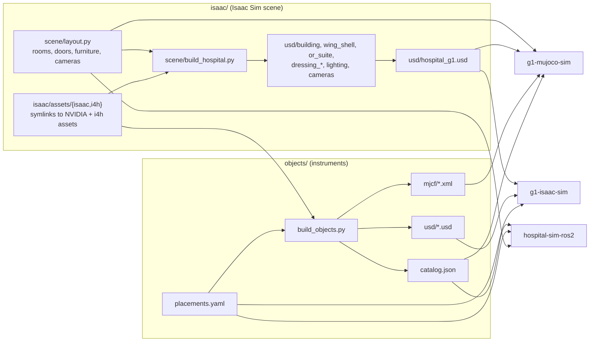

# hospital-sim-env: hospital scene, surgical wing and instruments

This repository is the simulated hospital, its surgical wing, and the surgical instruments that the robot
handles in the wing. Nothing in it knows about a particular robot. It has no robot model and no controller
code, so a different humanoid can use the same building. The scene and the object generator depend on no
sibling repository. Only the G1-specific check scripts in `objects/tools/` read `g1-brainco-description`.

Most people get this repository through the master repository `hospital-sim`. The master repository clones
every component side by side and carries `env.sh` and `docs/interfaces.md`, the contract between the parts.
Paths in this README are relative to this folder unless they name a sibling repository or the master
repository. Commands run from the root of the master checkout.

The repository has two halves, each with its own README:

| Folder | What | README |
|---|---|---|
| `isaac/` | Isaac Sim 6.0 scene: NVIDIA's Isaac `hospital.usd` building plus a surgical wing (link corridor, surgical corridor, pre-op, PACU, sterile store, scrub room, operating theatre). `isaac/scene/layout.py` is the single source of truth for room geometry, doorways, furniture and cameras; `isaac/scene/build_hospital.py` turns it into the USD layers under `isaac/usd/`. No physics is authored here | [isaac/README.md](isaac/README.md) |
| `objects/` | Scrub-nurse props as MJCF and physics-ready USD: 7 surgical instruments, tool rack, instrument table, surgeon mannequin, generated by `objects/build_objects.py`. `objects/placements.yaml` is the single source of object poses for both simulators; `objects/catalog.json` is the generated summary other components read | [objects/README.md](objects/README.md) |

Both halves share one world frame, the Isaac world. The wing origin is at (17.93, -4.45, 0) in that frame.

## How it works

The hospital half is in `isaac/`. The file `scene/layout.py` is plain Python data in a wing-local frame. It
holds:

- the room rectangles on a 2 m grid (`KIT_ROOMS`, `SUITE_ROOMS`);
- the wall openings and the door segments;
- the rotation of the i4h operating-room suite into the wing (`SUITE_TRANSLATE`, `SUITE_ROTATE_Z = -90`);
- the suite walls and props that the build removes, adds, moves or hides;
- every doorway with its 1 m clearance rule (`DOORWAYS`);
- one `dress_<room>()` function per room, which places furniture by asset key;
- the viewing cameras.

The script `scene/build_hospital.py` imports the layout together with `scene/assets.py`. The asset catalog
maps each asset key to a USD path through the `assets/isaac` and `assets/i4h` symlinks. The builder writes
one USD layer per concern with `pxr` only:

- The layer `building.usd` is the Isaac hospital with two SE door leaves deactivated.
- The layer `wing_shell.usd` has a Hospital_A kit floor and ceiling module per 2 m cell. A wall module sits
  on every boundary edge that is not a door or an opening. The door modules have their leaves switched off.
- The layer `or_suite.usd` references the i4h suite at scale 0.01, with overrides for door cuts, prop moves
  and instancing.
- The seven `dressing_<room>.usd` layers hold each prop as an instanceable reference, positioned from its
  own bounding box.
- The layer `lighting.usd` has room ceiling panels at 5000 K, plus a light under each ceiling fitting of
  the hospital.
- The layer `cameras.usd` has the viewing cameras.

The root stage `hospital_g1.usd` sublayers them all and is the file to open. The build then reopens the
root stage and checks it. The checks are:

- no furniture within 1 m of a doorway;
- no overlaps between placed or moved items;
- all dressing inside its room;
- no physics schemas in any layer;
- the GPU triangle count.

The result is `usd/build_report.json` and a printed issue list. The pass condition is `0 issues`. The build
also writes `video_hospital.usd` and `video_wing.usd`, which are reduced stages for the walkthrough render.

The instrument half is in `objects/`. The script `build_objects.py` has two kinds of instrument. Five real
meshes come from the i4h USDs (`REAL`). Two procedural stand-ins are built from boxes, capsules and tori
(`STANDIN`).

For a real mesh, the script opens the asset with `pxr` and collects the triangles under the listed prims,
grouped by material colour. It rotates them into a canonical frame: +z along the long axis towards the
handle, origin at the tip. It decimates the visual mesh to at most 12000 faces per colour. It builds the
collision as a stack of 10 mm axis-aligned boxes (`COLLISION_MODE = "slices"`); CoACD hulls are the
alternative. The mass is the catalogue value. The centre of mass and the inertia come from the collision
geometry at uniform density.

The script then sizes the rack from the instruments. Each guide hole is the swept collision section from
the tip to 2 mm above the guide top, plus 2.5 mm of clearance. A straight lift therefore always clears the
guide. The script writes every object in three forms:

- `meshes/<name>/visual_<k>.obj`;
- `mjcf/<name>.xml`, with a free joint, an inertial, visual and collision geoms and a grasp site;
- `usd/<name>.usd`, with `PhysicsRigidBodyAPI`, `MassAPI`, colliders and PhysX tuning. The real
  instruments reference the i4h asset through `../../isaac/assets/i4h/...` with the physics of the asset
  stripped.

The file `placements.yaml` gives the table, rack and surgeon poses and the slot order. The script composes
the world poses (table, rack on table, instrument in slot) into `mjcf/theatre_objects.xml` and
`catalog.json`. The script `build.sh` runs the generator under `uv` with Python 3.11. It then runs
`check_objects.py` under the master `.venv`. The check compiles every MJCF in MuJoCo, lets the instruments
settle in the rack for 3 s, and renders four preview images into `docs/`.

## Architecture

The diagram shows the data flow inside the repository and its edges to the sibling repositories.



The table lists the main modules and scripts.

| Piece | File | Role |
|---|---|---|
| Layout data | `isaac/scene/layout.py` | Wing-local room rectangles, openings, doors, suite edits, doorway clearance, furniture placement per room, cameras. Edit this to change the hospital |
| Asset catalog | `isaac/scene/assets.py` | Short asset key to USD path under `isaac/assets/isaac` and `isaac/assets/i4h` |
| Scene builder | `isaac/scene/build_hospital.py` | Writes the USD layers and `usd/build_report.json`, verifies clearances, overlaps, room bounds, no physics, GPU triangles |
| Asset switch | `isaac/scene/select_assets.py`, `make_lite_assets.py`, `decimate_lite_assets.py` | Build and select the 8 GB "lite" asset mirror or the original "full" assets |
| In-Isaac renders | `isaac/scene/render_views.py`, `render_walkthrough.py`, `walkthrough.py`, `make_video.py`, `image_stats.py` | Camera renders, path-traced walkthrough frames, video edit and encode, exposure check |
| Launcher | `isaac/launch_isaac.sh`, `isaac/scene/enable_mcp_late.py`, `isaac/i4h_env.sh` | Start Isaac Sim 6.0 with the asset root and MCP extension; asset environment variables |
| Object generator | `objects/build_objects.py`, `objects/build.sh` | i4h meshes + procedural definitions + `placements.yaml` to `meshes/`, `mjcf/`, `usd/`, `catalog.json` |
| Object poses | `objects/placements.yaml` | World poses of table, rack, surgeon; slot order; robot stances; props to remove |
| Object checks | `objects/check_objects.py`, `objects/tools/*.py` | MuJoCo compile and settle test; G1 reach and in-hand grasp tests |

## Dependencies

### System

The table lists the system tools, the versions on this machine and what uses them.

| Dependency | Version here | Used by |
|---|---|---|
| Ubuntu | 22.04.5 LTS | everything |
| Isaac Sim | 6.0.0-rc.59 at `~/isaacsim` (`ISAAC_DIR` overrides), ships Python 3.12 | `isaac/launch_isaac.sh`, the in-Isaac scripts (`render_views.py`, `render_walkthrough.py`, `enable_mcp_late.py`), opening the scene |
| NVIDIA GPU + driver | RTX 3070 8 GB, driver 580.178.04 | Isaac Sim RTX rendering. 8 GB needs the lite assets; the full assets need roughly 12 GB+ |
| `uv` | 0.12.19 | runs `objects/build_objects.py` (Python 3.11) and the offline Isaac scripts in throwaway environments |
| Python | 3.10.12 in the master `.venv` (system python with system site-packages) | `objects/check_objects.py`, `objects/tools/*.py` |
| Python | 3.11.16 (uv-managed) | `objects/build_objects.py` through `build.sh` |
| DejaVu fonts | `/usr/share/fonts/truetype/dejavu` (package `fonts-dejavu-core`) | `isaac/scene/make_video.py` title and captions |
| ffmpeg | none on the system; `make_video.py` uses the static binary bundled in the `imageio-ffmpeg` wheel | walkthrough video encode |
| Isaac Sim MCP extension | `~/Downloads/isaac-sim-mcp` (`MCP_EXT_DIR` overrides); optional | `launch_isaac.sh` enables it after startup so scripts can be run inside Isaac over MCP |

This repository needs no ROS 2, CUDA toolkit, conda or colcon.

### Python

Three interpreters run the scripts of this repository. The table gives the interpreter and the third-party
imports for each script.

| Script | Interpreter | Third-party imports | Version |
|---|---|---|---|
| `isaac/scene/build_hospital.py` (with `layout.py`, `assets.py`, `walkthrough.py`) | `uv run --no-project --with usd-core python ...`, or Isaac Sim's Python through `runpy` | `pxr` (`usd-core`) | usd-core 26.8 (unpinned; resolved 2026-10-10) |
| `isaac/scene/select_assets.py` | any `python3` | none | |
| `isaac/scene/make_lite_assets.py` | `uv run --no-project --with pillow python ...` | `PIL` | pillow 12.3.0 (unpinned) |
| `isaac/scene/decimate_lite_assets.py` | `uv run --no-project --with usd-core --with pymeshlab python ...` | `pxr`, `pymeshlab`, `numpy` | usd-core 26.8, pymeshlab 2025.7.post1, numpy 1.26.4 (unpinned) |
| `isaac/scene/make_video.py`, `image_stats.py` | `uv run --no-project --with pillow --with numpy --with imageio-ffmpeg python ...` | `PIL`, `numpy`, `imageio_ffmpeg` | pillow 12.3.0, numpy 1.26.4, imageio-ffmpeg 0.6.0 (unpinned) |
| `isaac/scene/render_views.py`, `render_walkthrough.py`, `enable_mcp_late.py` | inside Isaac Sim only (`runpy` over MCP, or `--exec`) | `omni.kit.app`, `omni.usd`, `omni.kit.viewport.utility`, `carb`, `pxr` | part of Isaac Sim 6.0; nothing to install |
| `objects/build_objects.py` | `uv run --no-project --python 3.11 --with ...` as in `objects/build.sh` | `numpy`, `trimesh`, `yaml`, `pxr`, `PIL`, `coacd` (hulls mode only) | see `requirements.txt`: usd-core 26.8, trimesh 5.1.1, coacd 1.0.14, numpy 2.4.6, scipy 1.17.1, pyyaml 6.0.3, pillow 12.3.0, fast-simplification 0.2.0, networkx 3.6.1 |
| `objects/check_objects.py` | master `.venv/bin/python` | `mujoco`, `numpy`, `PIL` | mujoco 3.14.0, numpy 1.26.4 (`.venv`); Pillow 9.0.1 from Ubuntu `python3-pil` (system site-packages, not in the `.venv` freeze) |
| `objects/tools/reach_check.py`, `g1_ik.py`, `hand_grasp_test_mujoco.py` | master `.venv/bin/python` | `mujoco`, `numpy`, `yaml`, `imageio` (`--video` only) | mujoco 3.14.0, numpy 1.26.4, PyYAML 6.0.3, imageio 2.38.0 (`.venv`) |

The file `requirements.txt` at the root of this folder pins the package set of the object generator. This
is the set that `build.sh` passes to `uv`. It is for `uv run --with-requirements` and not for the master
`.venv`. It carries numpy 2.4.6, while the `.venv` holds numpy 1.26.4. The Isaac side needs no pip install
beyond `usd-core` for the offline scripts. The in-Isaac scripts use only the modules that Isaac Sim ships.

### Data and assets not in git

The scene references two asset packs: the NVIDIA Isaac Sim 6.0 assets and the NVIDIA Isaac for Healthcare
(i4h) sim-ready asset catalog, version 0.7.0. NVIDIA's own tooling fetches them: the `i4h-digital-twin`
repository and its asset helper. The helper resolves assets as `$I4H_ASSET_DOWNLOAD_DIR/<catalog hash>/...`.
The file `isaac/i4h_env.sh` records the layout that this repository was built against:

| Variable | Value |
|---|---|
| `ISAAC_ASSET_ROOT` | `$HOME/isaacsim_assets/Assets/Isaac/6.0` |
| `I4H_REPO` | `$HOME/isaacsim_assets/i4h-digital-twin` |
| `I4H_ASSET_DOWNLOAD_DIR` | `$HOME/isaacsim_assets/Assets/Isaac/Healthcare/0.7.0` |
| `I4H_ASSET_ROOT` | `$I4H_ASSET_DOWNLOAD_DIR/724f82e` |

Two sets of symlinks point into that copy and must exist on your machine. They are in `.gitignore`.

- The symlink `isaac/i4h_assets` points at `I4H_ASSET_ROOT`, the catalog folder
  `.../Healthcare/0.7.0/724f82e`.
- The symlinks `isaac/assets/isaac` and `isaac/assets/i4h` are the paths that the USD layers and
  `objects/build_objects.py` load through. The script `isaac/scene/select_assets.py lite|full` switches
  them between the original assets and a mirror for 8 GB GPUs. The mirror has decimated meshes and capped
  textures (`~/isaacsim_assets/lite/...`, 2.6 GB here). See `isaac/README.md`.

The scene uses these parts of each pack:

- from the Isaac pack, `Isaac/Environments/Hospital/hospital.usd` and its `Props/`;
- from i4h, `Props/shared_OR_without_Mark` (the OR suite, the Hospital_A kit, surgery and patient room
  props, and signs) and `Props/Lightwheel/Assets`;
- from the i4h scissor workflow, `Props/SurgicalInstruments/SurgicalScissors.usd`.

This repository holds no datasets, weights or trained policies.

The licences differ per pack. The Isaac Sim hospital building is NVIDIA "Limited Use Content". The i4h
assets are Apache-2.0. The Lightwheel props inside i4h are CC BY-NC 4.0. Check these licences before public
or commercial use.

## Install

Run these commands in order from a fresh clone of the master repository `hospital-sim`. The master README
checks it out as `Hospital_G1`.

```bash
# 1. Clone the stack, including this repository
git clone https://github.com/Bkrakshith/hospital-sim.git Hospital_G1 && cd Hospital_G1
pip install vcstool && vcs import < hospital-sim.repos

# 2. Install uv. Unpack Isaac Sim 6.0 at ~/isaacsim, or export ISAAC_DIR
curl -LsSf https://astral.sh/uv/install.sh | sh

# 3. Fetch the Isaac Sim 6.0 asset pack and the i4h 0.7.0 catalog with NVIDIA's tooling into the
#    folders listed in isaac/i4h_env.sh. Then create the symlink that this repository expects
source hospital-sim-env/isaac/i4h_env.sh
ln -sfn "$I4H_ASSET_ROOT" hospital-sim-env/isaac/i4h_assets

# 4a. 8 GB GPU: build the lite mirror once (textures, then meshes) and point assets/ at it
uv run --no-project --with pillow python hospital-sim-env/isaac/scene/make_lite_assets.py
uv run --no-project --with usd-core --with pymeshlab python hospital-sim-env/isaac/scene/decimate_lite_assets.py
python3 hospital-sim-env/isaac/scene/select_assets.py lite
# 4b. GPU with 12 GB or more: use the original assets
python3 hospital-sim-env/isaac/scene/select_assets.py full

# 5. Activate the master .venv (mujoco 3.14.0) for objects/check_objects.py; see the Environments table of the master README
source env.sh
```

Steps 1 to 4 are enough to open the scene and to regenerate the objects. Only the MuJoCo checks need the
`.venv`.

## Run

These are the commands in daily use. The comment above each one says what it does and what to expect.

```bash
# Open the hospital in Isaac Sim in a new session. It enables the MCP extension, then loads usd/hospital_g1.usd
./hospital-sim-env/isaac/launch_isaac.sh --open

# Rebuild the USD layers after a change to isaac/scene/layout.py. It prints the report; expect "0 issues"
uv run --no-project --with usd-core python hospital-sim-env/isaac/scene/build_hospital.py

# Regenerate meshes/, mjcf/, usd/ and catalog.json from placements.yaml and the i4h meshes (about 1 min).
# Then it runs the MuJoCo checks
hospital-sim-env/objects/build.sh

# Switch the scene between the lite mirror and the original assets. No rebuild is needed
python3 hospital-sim-env/isaac/scene/select_assets.py lite   # or: full
```

The file `isaac/README.md` describes the renders and the walkthrough video. The file `objects/README.md`
describes the G1 reach and grasp tests.

## Test / check

The table lists each check command and its expected result.

| Command | Expected |
|---|---|
| `uv run --no-project --with usd-core python hospital-sim-env/isaac/scene/build_hospital.py` | JSON report then `0 issues`. Current `isaac/usd/build_report.json`: 10.1 M GPU triangles, 108 dressing items, 465 suite props, `physics_specs_authored: []`, `issues: []` |
| `.venv/bin/python hospital-sim-env/objects/check_objects.py` | 7 `settle` lines with `OK` (tilt under 12 deg, drift under 15 mm; current build at most 3.45 deg and 0.98 mm), `compile: 11/11 OK []`, `CHECK PASS`, exit 0. Writes `objects/docs/check_report.json` and four PNGs |

## Layout

The table lists the files and folders of this repository.

| Path | What |
|---|---|
| `README.md` | this file |
| `requirements.txt` | pinned Python set for `objects/build_objects.py` (the `uv --with` list in `objects/build.sh`) |
| `.gitignore` | ignores the machine-specific asset symlinks and Python caches |
| `isaac/scene/` | `layout.py`, `assets.py`, `build_hospital.py`, asset-mirror scripts, render and video scripts |
| `isaac/usd/` | generated USD layers, `hospital_g1.usd`, `video_*.usd`, `build_report.json` |
| `isaac/assets/`, `isaac/i4h_assets` | symlinks into the asset mirrors (not in git) |
| `isaac/renders/` | reference renders of the 11 cameras and `video/hospital_walkthrough_1080p.mp4` |
| `isaac/docs/` | design record of the wing and the 8 GB GPU investigation |
| `isaac/launch_isaac.sh`, `isaac/i4h_env.sh` | launcher and asset environment |
| `objects/build_objects.py`, `objects/build.sh`, `objects/check_objects.py` | generator and checks |
| `objects/placements.yaml` | object poses, slot order, robot stances, props to remove (edit this) |
| `objects/catalog.json` | generated summary read by the consumers |
| `objects/meshes/`, `objects/mjcf/`, `objects/usd/` | generated models |
| `objects/tools/` | G1 IK, reach check, in-hand grasp test (need `g1-brainco-description`) |
| `objects/docs/` | preview renders, `check_report.json`, `reach_report.json`, `hand_grasp_spec.json` |

## Interfaces to other repositories

This repository reads nothing from the sibling repositories at build time. The scripts in `objects/tools/`
read `g1-brainco-description/g1_29dof_brainco/mjcf/g1_29dof_brainco.xml` for the reach and grasp tests. The
table lists what this repository provides and who reads it. The binding contract is `docs/interfaces.md` in
the master repository.

| Provided | Format | Read by |
|---|---|---|
| `isaac/scene/layout.py` | Python module, wing-local metres, `WING_ORIGIN` to world | `g1-mujoco-sim` (`build_world.py`, `extract_scene_boxes.py`, `theatre.py`) rebuilds the walls from it; `g1-isaac-sim/make_stage.py`; `hospital-sim-ros2` (`g1_mission/scripts/make_locations.py`, `g1_navigation/scripts/rasterize_world.py`) |
| `isaac/usd/hospital_g1.usd` and its sublayers | USD, metres, z up, world frame | `g1-isaac-sim/make_stage.py` layers the robot and physics on top; `g1-mujoco-sim/extract_scene_boxes.py` extracts furniture boxes |
| `objects/mjcf/<name>.xml`, `mjcf/theatre_objects.xml` | MJCF, body `<name>` at the origin, mesh paths relative to `mjcf/` | `g1-mujoco-sim` and `hospital-sim-ros2/g1_mujoco_sim` attach them at the `catalog.json` poses |
| `objects/usd/<name>.usd` | USD, defaultPrim `/<name>`, rigid body + colliders | `g1-isaac-sim/make_theatre_layer.py` |
| `objects/placements.yaml` | YAML, world frame, yaw in radians | `g1-isaac-sim/make_theatre_layer.py`, `g1-mujoco-sim`, `hospital-sim-ros2` mission locations |
| `objects/catalog.json` | JSON: `labels`, per-instrument dimensions, mass, inertia, grasp region, `rack.slots`, `world_poses` (pos + wxyz quaternion), `robot_stances`, `remove_scene_props` | `g1-mujoco-sim/theatre.py`, `g1-isaac-sim`, `hospital-sim-ros2` (`g1_mission`, `g1_perception/gt.py`). Any perception pipeline can use the names in `labels` as class labels |
| World frame | wing origin at world (17.93, -4.45, 0); theatre spans world x 17.93..27.93, y -24.45..-14.45 | all of the above |

## License

The license of this repository is the Apache License, Version 2.0 (see `LICENSE`).
You can use, change and share this work, also for commercial use.
If you share this work or a work that you built on it, keep the `NOTICE` file.
Give this credit in your documentation and product credits: "Based on hospital-sim by Bkrakshith (https://github.com/Bkrakshith/hospital-sim)".
To cite this work in a publication, use `CITATION.cff`.
Some third-party parts keep their own licences. The `NOTICE` file lists them.
