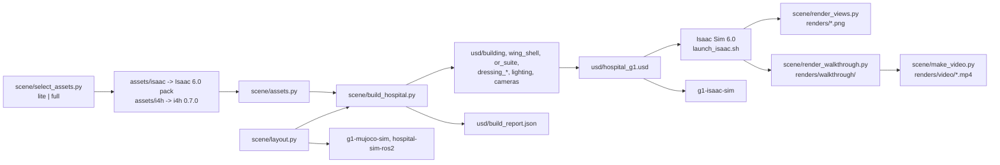

# isaac: the Isaac Sim hospital scene

This folder is the `isaac/` half of `hospital-sim-env`. It holds NVIDIA's Isaac `hospital.usd` building with
a surgical wing attached at its south-east door, for Isaac Sim 6.0. The wing has seven spaces:

- a link corridor;
- a surgical corridor;
- pre-op;
- recovery (PACU);
- a sterile store;
- a scrub room;
- a fully fitted operating theatre (the Isaac for Healthcare OR suite).

The scene is built for a Unitree G1 but contains no robot. It has one floor level, 2 m and 4 m corridors
and 2 m clear doorways. The build keeps furniture at least 1 m from every opening. The file
[../README.md](../README.md) lists who consumes the scene, the asset packs it needs, the symlinks and the
licences. This file covers the scene itself.

Paths are relative to this folder. The `uv run ... python scene/...` commands run from this folder;
`launch_isaac.sh` runs from anywhere. Until the split into component repositories, this folder was
`sim/isaac/hospital/` in the master repository.

This scene authors no physics. The robot stages in `g1-isaac-sim/usd/` add colliders on top of it through
`g1-isaac-sim/make_stage.py`. Some referenced assets bring their own physics. The Isaac hospital has static
colliders, and the Lightwheel props have rigid bodies and colliders.

## How it works

The file `scene/layout.py` holds the whole design as data in a wing-local frame. The frame is in metres, its
axes are aligned with the world, and its origin is `WING_ORIGIN = (17.93, -4.45, 0)`. That point is the west
edge of the link corridor on the south wall of the hospital. The main entries are:

- `KIT_ROOMS`: the four rooms built from the i4h Hospital_A 2 m kit (Link, PreOp, PACU, Corridor), as
  `(x0, y0, x1, y1)` rectangles on the 2 m grid.
- `SUITE_ROOMS`: Store, Scrub and Theatre. These are only dressing frames, because the i4h OR suite
  provides their shell.
- `OPENINGS` and `WING_DOORS`: the wall segments that stay open or get a double-door module.
- `SUITE_TRANSLATE = (0, -12, 0)`, `SUITE_ROTATE_Z = -90` and scale 0.01: the placement of the suite, which
  is authored in cm.
- `SUITE_REMOVE`, `SUITE_ADD`, `SUITE_MOVES`, `SUITE_MOVE_WITH`, `SUITE_HIDE` and `SUITE_OPEN_DOORS`: the
  suite wall modules and props that the build cuts, adds, moves, hides or opens. These edits make three
  corridor doors and the store and scrub rooms.
- `DOORWAYS`: every clear opening, with `DOOR_CLEARANCE = 1.0`.
- `BACK`: the side of each asset that goes against a wall.
- `dress_<room>(r)`: one function per room. It places furniture with `r.wall(name, key, wall, u, z)` (flush
  against a wall at distance `u` along it) or with `r.put(name, key, x, y, yaw, z)`.
- `CAMERAS`: camera name to (eye, target, focal length).

The script `scene/build_hospital.py` turns that data into layers under `usd/`. It uses `pxr` only, so it
needs no Isaac Sim. Its functions run in this order:

1. `build_building()` references the Isaac hospital into `building.usd` and deactivates the two SE door
   leaves.
2. `build_wing_shell()` writes `wing_shell.usd`. It places a kit centre module (floor and ceiling) per 2 m
   cell, and a straight wall module on each boundary edge that no opening or door covers. It adds door
   modules with leaves and skirting switched off. It adds three boxes that close the gap between the 2 m
   link and the 2.56 m doorway of the hospital.
3. `build_or_suite()` references the `/World` of the i4h suite into `or_suite.usd` with overrides only. It
   deactivates the removed walls and the hidden props. It puts replacement door and wall modules under
   `ORSuiteMods`. It re-poses the moved props with a world matrix computed from the bounding boxes of the
   source stage. It makes every prop instanceable and dims the suite's own lights by `LIGHT_LEVEL`.
4. `build_dressing()` writes `dressing_<room>.usd` for the seven rooms. For each item, it opens the asset
   once for its bounding box and `metersPerUnit`. It puts a slot Xform at the room position and an
   instanceable `Asset` child that re-centres the prop on its footprint.
5. `build_cameras()` writes ten perspective cameras and the orthographic `Cam_Plan`.
6. `build_lighting()` writes `lighting.usd` (default `HG1_LIGHTS=rooms`). It places a grid of 1.2 m rect
   lights about 3.2 m apart at z 3.45 m in every room, at 5000 K. It adds a rect or disk light under each of
   the 153 ceiling fittings of the hospital.
7. `build_root()` writes `hospital_g1.usd`. Its sublayers are, strongest first: cameras, lighting, the seven
   dressing layers, or_suite, wing_shell, building.
8. `build_video_stages()` writes `video_hospital.usd` and `video_wing.usd`. Each is the root minus the prims
   that a shot group never sees.
9. `verify()` reopens the root and writes `usd/build_report.json`. The report covers doorway clearance,
   overlaps and dressing outside its room. It also lists any `Physics*` or `Physx*` API schema in our
   layers, and the GPU triangle count (instances counted once). The script prints the report and
   `N issues`.

Rendering happens inside Isaac Sim. The script `launch_isaac.sh` runs `~/isaacsim/isaac-sim.sh` with the
asset root and `--exec scene/enable_mcp_late.py`. That script enables the MCP extension 120 frames after
startup and opens the stage named by `HG1_OPEN_STAGE`, which `--open` sets. The scripts
`scene/render_views.py` and `scene/render_walkthrough.py` run inside that session through `runpy`. They
return at once and write their progress to `renders/status.json` or `renders/walkthrough/status.json`.

The file `scene/walkthrough.py` is the shot list (pure data). The script `scene/make_video.py` does the edit
and the H.264 encode, and `scene/image_stats.py` does the exposure check.

## Architecture

The diagram shows the pieces of this folder and the data flow between them.



The table lists the main pieces and their files.

| Piece | File | Role |
|---|---|---|
| Layout | `scene/layout.py` | edit this to change rooms, doors, furniture, cameras |
| Asset catalog | `scene/assets.py` | short key to USD path; `build_catalog()` resolves the i4h folders to their top-level `.usd` |
| Builder | `scene/build_hospital.py` | writes the layers, `video_*.usd` and `build_report.json`; verifies |
| Asset mirror | `scene/make_lite_assets.py`, `scene/decimate_lite_assets.py`, `scene/select_assets.py` | textures, meshes and symlinks for the 8 GB mirror |
| Launcher | `launch_isaac.sh`, `scene/enable_mcp_late.py`, `i4h_env.sh` | Isaac Sim with the asset root and MCP; asset environment variables |
| Renders | `scene/render_views.py`, `scene/image_stats.py` | every camera to `renders/`; exposure stats |
| Video | `scene/walkthrough.py`, `scene/render_walkthrough.py`, `scene/make_video.py` | shots, path-traced frames, edit and encode |

## Dependencies

The system dependencies are:

- Ubuntu 22.04;
- Isaac Sim 6.0.0-rc.59 at `~/isaacsim` (`ISAAC_DIR` overrides);
- an RTX GPU: 8 GB with the lite assets, about 12 GB or more for the full assets;
- `uv` 0.12.19;
- DejaVu fonts (`fonts-dejavu-core`) for `make_video.py`;
- the Isaac Sim MCP extension at `~/Downloads/isaac-sim-mcp` (`MCP_EXT_DIR` overrides), optional.

No system ffmpeg is needed, because `imageio-ffmpeg` bundles a static binary. The asset packs and symlinks
are in [../README.md](../README.md#data-and-assets-not-in-git).

The Python packages are listed per script in the table. Nothing is installed permanently:
`uv run --no-project --with ...` makes a throwaway environment each time. The versions are as resolved on
2026-10-10 and are unpinned.

| Script | Interpreter | Imports | Version |
|---|---|---|---|
| `scene/build_hospital.py`, `layout.py`, `assets.py`, `walkthrough.py` | `uv run --no-project --with usd-core python`, or Isaac Sim's Python through `runpy` | `pxr` | usd-core 26.8 |
| `scene/select_assets.py` | `python3` | stdlib only | |
| `scene/make_lite_assets.py` | `uv run --no-project --with pillow python` | `PIL` | pillow 12.3.0 |
| `scene/decimate_lite_assets.py` | `uv run --no-project --with usd-core --with pymeshlab python` | `pxr`, `pymeshlab`, `numpy` | usd-core 26.8, pymeshlab 2025.7.post1, numpy 1.26.4 |
| `scene/make_video.py`, `scene/image_stats.py` | `uv run --no-project --with pillow --with numpy --with imageio-ffmpeg python` | `PIL`, `numpy`, `imageio_ffmpeg` | pillow 12.3.0, numpy 1.26.4, imageio-ffmpeg 0.6.0 |
| `scene/render_views.py`, `scene/render_walkthrough.py`, `scene/enable_mcp_late.py` | inside Isaac Sim 6.0 (Python 3.12) | `omni.kit.app`, `omni.usd`, `omni.kit.viewport.utility`, `carb`, `pxr` | shipped with Isaac Sim |

## Opening the scene

Run the launcher with `--open`:

```bash
./launch_isaac.sh --open      # runs Isaac Sim with the MCP extension, then opens usd/hospital_g1.usd
```

The scene includes viewing cameras under `/World/Cameras`. Select one from the camera menu of the viewport.
The table lists the cameras and their views.

| Camera | View |
|---|---|
| `Cam_HospitalToWing` | from the hospital corridor through the SE door into the wing |
| `Cam_Link`, `Cam_CorridorWest`, `Cam_CorridorEast` | link corridor, surgical corridor both ways |
| `Cam_PreOp`, `Cam_PACU`, `Cam_Store`, `Cam_Scrub` | each room from its doorway |
| `Cam_Theatre`, `Cam_TheatreWide` | operating theatre |
| `Cam_Plan` | orthographic top-down plan (sits directly under the ceiling) |

Reference renders of every camera are in `renders/`.

## Layout (wing-local metres, origin at the hospital's SE door)

```
 y=0   ────────────── hospital south wall ── [SE double door] ──────────────
       |      PRE-OP (x -10..0)      | LINK |          PACU (x 2..14)          |
 y=-6  ───────────[door]─────────────       ───────────[door]─────────────────
       |                  SURGICAL CORRIDOR (x -12..14)                        |
 y=-10 ──[door]────────────┬─[door]─┬──────────[door]────────────────────────
       |  STERILE STORE    | SCRUB  |          OPERATING THEATRE (x 0..10)
 y=-18 ────────────────────┴────────┤                                       y=-20
```

The origin of the wing is at world (17.93, -4.45, 0). The build rotates the i4h OR suite by -90 deg, so its
three rooms (side room, anteroom, theatre) open onto the corridor. Its side room becomes the sterile store,
and its anteroom becomes the scrub room.

## Files

The table lists the files of this folder.

| Path | What |
|---|---|
| `usd/hospital_g1.usd` | root stage (sublayers below); open this one |
| `usd/building.usd` | Isaac hospital, with the SE door leaves removed |
| `usd/wing_shell.usd` | floors, ceilings, walls and doors built from the i4h Hospital_A 2 m kit |
| `usd/or_suite.usd` | i4h OR suite placed into the wing; door cuts and prop moves are overrides only |
| `usd/dressing_<room>.usd` | furniture per room (link, preop, pacu, corridor, store, scrub, theatre) |
| `usd/lighting.usd`, `usd/cameras.usd` | room ceiling lights, viewing cameras |
| `usd/video_hospital.usd`, `usd/video_wing.usd` | the root minus what each walkthrough shot group never sees |
| `usd/build_report.json` | last build's checks: doorway clearance, overlaps, room bounds, physics, GPU triangles |
| `scene/layout.py` | edit this to change rooms, doors, furniture, cameras |
| `scene/build_hospital.py` | turns `layout.py` into the USD layers and verifies them |
| `scene/assets.py` | asset catalog (short key to USD path) |
| `scene/make_lite_assets.py`, `scene/decimate_lite_assets.py`, `scene/select_assets.py` | the 8 GB asset mirror (below) |
| `scene/render_views.py` | renders every camera to `renders/` from inside Isaac Sim (for example over MCP) |
| `launch_isaac.sh`, `scene/enable_mcp_late.py` | Isaac launcher; enables the MCP extension after startup |
| `i4h_env.sh` | asset environment variables (see `../README.md`) |
| `scene/walkthrough.py`, `scene/render_walkthrough.py`, `scene/make_video.py` | walkthrough video: shots, path-traced frames, edit + encode |
| `scene/image_stats.py` | exposure check for renders (median brightness, % clipped) |
| `assets/isaac`, `assets/i4h`, `i4h_assets` | symlinks into the asset mirrors, not in git |
| `renders/` | one PNG per camera; `renders/video/hospital_walkthrough_1080p.mp4` |
| `docs/2026-09-29-hospital-surgical-wing-design.md` | design record and the GPU memory investigation |

## Rebuilding the scene

Run the build after every change to `layout.py`:

```bash
uv run --no-project --with usd-core python scene/build_hospital.py
```

The build prints the report and exits with its issue list. The scene needs `0 issues` before use. The
current report has 10.1 million GPU triangles, 108 dressing items, 465 suite props, no physics specs and no
issues.

CAUTION: Open the rebuilt stage in a new Isaac Sim session.

A reopen in the same session keeps the GPU memory of the old stage. That is enough to push an 8 GB card
over its limit.

## Fitting an 8 GB GPU (RTX 3070)

At full fidelity the scene needs about 12 GB or more of VRAM. The i4h props are film-density: for example, a
mask box has 1.1 million triangles and the drug cabinets have 1.6 million triangles. RTX runs out of memory
when it builds their ray-tracing structures. The scene therefore loads assets through `assets/isaac` and
`assets/i4h`, which point to one of two asset sets:

- lite (default): `~/isaacsim_assets/lite/...`, a mirror of the asset trees in use. The mirror scripts
  simplify every i4h and Lightwheel asset to at most 25,000 triangles and keep the UVs. They cap textures:
  1600 px and above go to 1024 px, 513 px to 1024 px go to 512 px, and smaller textures are kept. They
  hard-link untouched files and never modify the original assets. They symlink the folders that the scene
  does not use to the originals.
- full: the original assets, for a GPU with 12 GB or more.

Build the mirror once, then select it:

```bash
uv run --no-project --with pillow python scene/make_lite_assets.py                       # textures + hard links
uv run --no-project --with usd-core --with pymeshlab python scene/decimate_lite_assets.py # meshes (--budget 25000 default)
python3 scene/select_assets.py lite     # or: full   (no rebuild needed)
```

The script `decimate_lite_assets.py` unlinks a file from its original before it edits the file. It decimates
meshes above 2000 triangles with texture-preserving quadric edge collapse. It rebuilds face-varying normals
with a 40 deg crease. It leaves meshes with GeomSubsets or extra primvars alone and reports them on stdout.

Lighting has the same kind of switch. By default, the build replaces the about 400 per-module kit lights
with about 40 room ceiling panels. It also gives every one of the 153 ceiling fittings of the hospital a real
light; the building ships with only a dome light. The setting `HG1_LIGHTS=kit` keeps every kit light, which
only fits larger GPUs. The setting `HG1_LIGHTS=none` strips them without replacement, for diagnostics.

The light levels are calibrated, not guessed. The constant `LIGHT_LEVEL` in `build_hospital.py` puts the
median pixel at about 0.5 with nothing clipped under the default ACES exposure. The colour temperature is
5000 K. The command `scene/image_stats.py renders/*.png` measures this. Before the calibration, 20 % or more
of the room pixels were clipped to white.

The VRAM use was measured on the RTX 3070 with lite assets, room lights and real-time RTX. All 11 cameras
rendered with a peak of about 6.3 GB to 7.0 GB. This included about 1.9 GB of desktop and Isaac overhead.

## Rendering the cameras

Run this inside a running Isaac Sim session, over MCP or in the script console:

```python
import runpy; runpy.run_path("<this folder>/scene/render_views.py", run_name="__main__")
```

The script opens `usd/hospital_g1.usd` if it is not the current stage and waits for loading. It holds 90
frames per camera for RTX accumulation and texture streaming. It writes `renders/<camera>.png` and its
progress to `renders/status.json`. Three environment variables control it:

- `RENDER_CAMERAS=a,b` renders a subset of the cameras.
- `RENDER_REOPEN=1` reloads the stage.
- `RENDER_RESOLUTION=WxH` resizes the viewport.

CAUTION: Do not set `RENDER_RESOLUTION` on an 8 GB GPU, because it reallocates every RTX buffer.

## Walkthrough video

The walkthrough is a path-traced video of about 44 s at 1920x1080 and 30 fps. It has a title card, eight
shots of 5 s each with 0.5 s crossfades and captions, and a credits card. The credits name NVIDIA Isaac for
Healthcare, Lightwheel and NVIDIA Isaac Sim. The shots are:

- the hospital corridor;
- the link;
- the surgical corridor;
- pre-op;
- the PACU;
- the sterile store;
- the scrub room;
- a theatre orbit.

Render each shot group, then build the video:

```bash
# Render each group in its own new Isaac Sim session. The frames are resumable if a session dies.
./launch_isaac.sh     # then over MCP:  WALK_GROUP=hospital, runpy scene/render_walkthrough.py
./launch_isaac.sh     # restart, then:  WALK_GROUP=wing
uv run --no-project --with pillow --with numpy --with imageio-ffmpeg python scene/make_video.py
```

- The shots, captions and credits are in `scene/walkthrough.py`. The stages `usd/video_hospital.usd` and
  `usd/video_wing.usd` are the full scene minus what their shots never see. Path tracing at 1080p does not
  fit in 8 GB with everything loaded.
- The variable `WALK_SPP` sets the samples per frame (default 128). The video used 96 samples, denoised.
  One frame took about 21 s on the RTX 3070, so the full render takes several hours. The variable
  `WALK_PREVIEW=1` renders 3 frames per shot to check the camera paths. The variable `WALK_SHOTS=a,b`
  renders a subset.
- The frames land in `renders/walkthrough/<shot>/0000.png...`. Git keeps only the finished video, not the
  frames.
- The `imageio-ffmpeg` package provides ffmpeg as a bundled static binary, so no system install is needed.
- The command `make_video.py --draft` builds the edit from the frames that exist.
- The licences are in `../README.md`. The credits and the watermark name the asset sources.

## Notes for adding G1 and physics later

- The furniture and the i4h props are USD instances, so identical props share GPU memory. Author collision
  on the instance root or in the referenced asset, not on instance-proxy children.
- The Lightwheel carts and trays carry their own rigid bodies. Decide whether to keep or disable them when
  you set up physics.
- The build check keeps every doorway in `layout.DOORWAYS` clear. The build removes the leaves of the
  scrub-to-store double door, so the G1 can pass through.
- The list `HOSPITAL_FIXTURES` in `layout.py` names the hospital fitting prefixes that get real lights
  (`Light_test` panels, `Geo_M_Light2_low` downlights). Edit `SUITE_HIDE` and `SUITE_MOVES` if a prop is in
  the way of the robot.

## Known limits

- With the lite assets, close-up edges on i4h props are simplified and textures are softer. Switch to the
  full assets on a bigger GPU with `scene/select_assets.py full`.
- The mirror leaves a few i4h parts undecimated because they carry second UV sets or GeomSubsets. These
  parts are the endoscope, the microscope, the breathing circuits and the Lightwheel trolley.
- The build leaves the hospital's own doors as authored, except the SE door that the wing uses.
- On this machine, the `--enable` flag for the MCP extension crashed Isaac Sim 6.0 during startup
  (`NULL TfWeakPtr<UsdStage>`). The script `enable_mcp_late.py` therefore enables the extension after
  startup. The root cause is not identified. The full investigation of the 8 GB memory limit is in
  `docs/2026-09-29-hospital-surgical-wing-design.md`.
