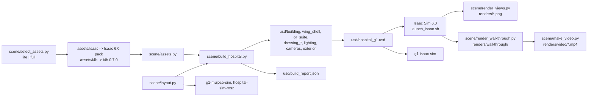

# isaac: the Isaac Sim hospital scene

This folder is the `isaac/` half of `hospital-sim-env`. It holds NVIDIA's Isaac `hospital.usd` building with
a surgical wing attached at its south-east door, for Isaac Sim 6.0. The wing has eight spaces:

- a link corridor;
- a surgical corridor;
- pre-op;
- recovery (PACU);
- a sterile store;
- a scrub room;
- a fully fitted operating theatre (the Isaac for Healthcare OR suite);
- a bed-lift lobby with two bed lifts.

The wing has seven fire doorsets (one of them a final exit to outside) and the two bed lifts as moving fixtures
with physics (see [Fire doors and bed lifts](#fire-doors-and-bed-lifts)). The main building adds up to 15 fire
doorsets and a second pair of bed lifts. The fixture tier sets how many of them the scene has. The file
`docs/uk-guidance-compliance.md` checks the layout against UK hospital guidance. It follows the guidance for robot
testing. It is not a certified design.

The ground floor of the main building is re-planned (see [Main building re-plan](#main-building-re-plan)):

- a 6-bed adult in-patient ward with en-suite single rooms in the east corridor;
- a small emergency department (A&E) in the west corridor and the west hall;
- three fire compartments with new compartment screens, stair enclosures and fire doorsets;
- a pair of bed lifts in a protected lobby off the main corridor;
- a 4 m link to the wing (3.8 m clear corridor; the hospital doorway is 2.73 m clear). The link took 2 m from
  the wing PACU, which is now 10 m x 6 m with 3 recovery bays.

The re-plan is HBN/HTM-informed. No fire engineer or clinical planner reviewed it, so do not call it compliant.

Outside, the scene has a drive with two patient-transport bays at the main entrance. An A&E lane leads west to
an apron, the ambulance bay AE1 and a canopy at the south courtyard, where a UK emergency ambulance stands
(see [Exterior](#exterior-drive-ae-entrance-and-ambulance)).

The scene is built for a Unitree G1 but contains no robot. It has one floor level. The wing corridors, the link
included, are 4 m on the grid. The wing doorways are about 1.8 m clear. The build keeps furniture at least 1 m
from every opening. The file [../README.md](../README.md) lists who consumes the scene, the asset packs it needs, the symlinks and the
licences. This file covers the scene itself.

Paths are relative to this folder. The `uv run ... python scene/...` commands run from this folder;
`launch_isaac.sh` runs from anywhere. Until the split into component repositories, this folder was
`sim/isaac/hospital/` in the master repository.

This scene authors physics only in `usd/fixtures.usd`, for the fire doors, the lifts and their buttons. The
robot stages in `g1-isaac-sim/usd/` add the PhysicsScene and the colliders on top of it through
`g1-isaac-sim/make_stage.py`. That script also adds box colliders for the drive, the kerbs, the canopy and sign
posts, the ambulance and the static partitions of the main building.
Some referenced assets bring their own physics. The Isaac hospital has static
colliders, and the Lightwheel props have rigid bodies and colliders.

## How it works

The file `scene/layout.py` holds the whole design as data in a wing-local frame. The frame is in metres, its
axes are aligned with the world, and its origin is `WING_ORIGIN = (17.93, -4.45, 0)`. That point is the west
edge of the link corridor on the south wall of the hospital. The main entries are:

- `KIT_ROOMS`: the five rooms built from the i4h Hospital_A 2 m kit (Link, PreOp, PACU, Corridor, LiftLobby),
  as `(x0, y0, x1, y1)` rectangles on the 2 m grid.
- `SUITE_ROOMS`: Store, Scrub and Theatre. These are only dressing frames, because the i4h OR suite
  provides their shell.
- `OPENINGS` and `WING_DOORS`: the wall segments that stay open or get a 4 m double-door module. A module on a
  segment with constant y (PreOp, PACU, FinalExit) has no rotation. A module on a segment with constant x
  (CrossCorridor, LiftLobby) turns +90 deg and starts at the south end. The lobby's east side is an opening: the lift fronts close it.
- `PARTITIONS`: interior wall lines that are not room edges (the fire-door line x = 4 across the corridor).
- `FIRE_DOORS`, `LIFTS`, `LIFT_SPEC` and `LIFT_CALL`: the fire doorsets, the bed lifts and the call button,
  with the UK guidance for each value (HTM 05-02, HTM 08-02, HBN 00-04, Approved Document M).
- `EXIT_PATH`: the paved path and the lawn outside the final exit (visual only, in `usd/exterior.usd`).
- `SUITE_TRANSLATE = (0, -12, 0)`, `SUITE_ROTATE_Z = -90` and scale 0.01: the placement of the suite, which
  is authored in cm.
- `SUITE_REMOVE`, `SUITE_ADD`, `SUITE_MOVES`, `SUITE_MOVE_WITH`, `SUITE_HIDE` and `SUITE_OPEN_DOORS`: the
  suite wall modules and props that the build cuts, adds, moves, hides or opens. These edits make three
  corridor doors and the store and scrub rooms.
- `DOORWAYS`: every clear opening, with `DOOR_CLEARANCE = 1.0`.
- `BACK`: the side of each asset that goes against a wall.
- `dress_<room>(r)`: one function per room. It places furniture with `r.wall(name, key, wall, u, z)` (flush
  against a wall at distance `u` along it) or with `r.put(name, key, x, y, yaw, z)`.
- `CAMERAS`: camera name to (eye, target, focal length). The end of `layout.py` merges the world-frame
  `EXTERIOR["cameras"]` and `BUILDING_CAMERAS` into it.
- `BUILDING_*`: the main-building re-plan, in the world frame (see
  [Main building re-plan](#main-building-re-plan)).

The script `scene/build_hospital.py` turns that data into layers under `usd/`. It uses `pxr` only, so it
needs no Isaac Sim. Its functions run in this order:

1. `build_building(spec)` references the Isaac hospital into `building.usd`. It deactivates the two SE door
   leaves and the prims of `hospital_fixtures.building_hide()` for the active fixture tier. At tier 2 and up, it
   also deactivates the two glass units of the main entrance. It points the hospital's dome light at the
   overcast sky `CloudyDay_04_04.hdr` of the i4h pack, at intensity 1000 (`HG1_DOME_INTENSITY`). The sky that the
   asset names is not in the local packs: RTX then sometimes drew a white sky and outdoor views clipped.
2. `BuildingMeshes` reads the active building meshes once (world triangles and their materials). The next
   steps and `verify()` use it.
3. `build_wing_shell()` writes `wing_shell.usd`. It places a kit centre module (floor and ceiling) per 2 m
   cell, and a straight wall module on each boundary edge that no opening or door covers. It adds door
   modules with leaves and skirting switched off.
4. `build_building_mods()` writes `building_mods.usd`. It draws every box of
   `hospital_fixtures.static_partitions()` (screens, partitions, rebuilt walls, the link junction boxes) in
   the building's own wall materials, and a thin panel for each new ceiling light.
5. `build_or_suite()` deactivates the suite's own dome light, so the scene has one sky. It references the `/World` of the i4h suite into `or_suite.usd` with overrides only. It
   deactivates the removed walls and the hidden props. It puts replacement door and wall modules under
   `ORSuiteMods`. It re-poses the moved props with a world matrix computed from the bounding boxes of the
   source stage. It makes every prop instanceable and dims the suite's own lights by `LIGHT_LEVEL`.
6. `build_dressing()` writes `dressing_<room>.usd` for the eight wing rooms. For each item, it opens the asset
   once for its bounding box and `metersPerUnit`. It puts a slot Xform at the room position and an
   instanceable `Asset` child that re-centres the prop on its footprint.
7. `build_building_dressing()` writes `dressing_bldg_ward.usd`, `dressing_bldg_ae.usd` and
   `dressing_bldg_central.usd` from `BUILDING_DRESSING`, under `/World/Building/Dressing` in the world frame.
8. `build_fixtures()` writes `fixtures.usd` through `scene/fixtures_usd.py` (see
   [Fire doors and bed lifts](#fire-doors-and-bed-lifts)).
9. `build_cameras()` writes the perspective cameras of `layout.CAMERAS` and the orthographic `Cam_Plan`.
10. `build_lighting()` writes `lighting.usd` (default `HG1_LIGHTS=rooms`). It places a grid of 1.2 m rect
   lights about 3.2 m apart at z 3.45 m in every room, at 5000 K. It adds a rect or disk light under each of
   the 147 active ceiling fittings of the hospital, and the 9 panels of `BUILDING_LIGHTS`.
11. `build_exterior.build()` (file `scene/build_exterior.py`) writes `exterior.usd`. It holds the drive, the A&E
   lane and apron, the canopy, the sign and the ambulance in the world frame, from `layout.EXTERIOR`.
12. `build_root()` writes `hospital_g1.usd`. Its sublayers are, strongest first: cameras, lighting, fixtures,
   exterior, the eight wing dressing layers, the three building dressing layers, building_mods, or_suite,
   wing_shell, building.
13. `build_video_stages()` writes `video_hospital.usd` and `video_wing.usd`. Each is the root minus the prims
   that a shot group never sees.
14. `verify()` reopens the root and writes `usd/build_report.json`. The report covers doorway clearance,
   the swept area of every fire-door leaf, the bed-turning space in front of each lift (HBN 00-04 Fig 28),
   overlaps and dressing outside its room. It lists the fixtures (articulations, joints, initial positions). It also lists any `Physics*` or `Physx*` API schema in our
   layers outside `/World/Fixtures`, and the GPU triangle count (instances counted once). The script prints the report and
   `N issues`. It also runs `build_exterior.check()` (see [Exterior](#exterior-drive-ae-entrance-and-ambulance)). For the
   main building it checks, in the world frame:
   - dressing inside its room, and clear of the building's own furniture and wall meshes (slices at 0.3, 1.0
     and 1.6 m);
   - 1 m each side of every `BUILDING_DOORWAYS` opening;
   - the swing of every fire-door leaf of the `full` tier and the bed-turning space of all four lifts;
   - partitions clear of furniture and dressing; the main lift cars and fronts clear of building prims;
   - a light in every room of `BUILDING_ROOMS`.

Rendering happens inside Isaac Sim. The script `launch_isaac.sh` runs `~/isaacsim/isaac-sim.sh` with the
asset root and `--exec scene/enable_mcp_late.py`. That script enables the MCP extension 120 frames after
startup and opens the stage named by `HG1_OPEN_STAGE`, which `--open` sets. The scripts
`scene/render_views.py` and `scene/render_walkthrough.py` run inside that session through `runpy`. They
return at once and write their progress to `renders/status.json` or `renders/walkthrough/status.json`.

The file `scene/walkthrough.py` is the shot list (pure data). The script `scene/make_video.py` does the edit
and the H.264 encode, and `scene/image_stats.py` does the exposure check.

## Architecture

The diagram shows the pieces of this folder and the data flow between them.



The table lists the main pieces and their files.

| Piece | File | Role |
|---|---|---|
| Layout | `scene/layout.py` | edit this to change rooms, doors, furniture, cameras |
| Asset catalog | `scene/assets.py` | short key to USD path; `build_catalog()` resolves the i4h folders to their top-level `.usd` |
| Builder | `scene/build_hospital.py` | writes the layers, `video_*.usd` and `build_report.json`; verifies |
| Asset mirror | `scene/make_lite_assets.py`, `scene/decimate_lite_assets.py`, `scene/select_assets.py` | textures, meshes and symlinks for the 8 GB mirror |
| Launcher | `launch_isaac.sh`, `scene/enable_mcp_late.py`, `i4h_env.sh` | Isaac Sim with the asset root and MCP; asset environment variables |
| Renders | `scene/render_views.py`, `scene/image_stats.py` | every camera to `renders/`; exposure stats |
| Video | `scene/walkthrough.py`, `scene/render_walkthrough.py`, `scene/make_video.py` | shots, path-traced frames, edit and encode |

## Dependencies

The system dependencies are:

- Ubuntu 22.04;
- Isaac Sim 6.0.0-rc.59 at `~/isaacsim` (`ISAAC_DIR` overrides);
- an RTX GPU: 8 GB with the lite assets, about 12 GB or more for the full assets;
- `uv` 0.12.19;
- DejaVu fonts (`fonts-dejavu-core`) for `make_video.py`;
- the Isaac Sim MCP extension at `~/Downloads/isaac-sim-mcp` (`MCP_EXT_DIR` overrides), optional.

No system ffmpeg is needed, because `imageio-ffmpeg` bundles a static binary. The asset packs and symlinks
are in [../README.md](../README.md#data-and-assets-not-in-git).

The Python packages are listed per script in the table. Nothing is installed permanently:
`uv run --no-project --with ...` makes a throwaway environment each time. The versions are as resolved on
2026-10-10 and are unpinned.

| Script | Interpreter | Imports | Version |
|---|---|---|---|
| `scene/build_hospital.py`, `layout.py`, `assets.py`, `walkthrough.py` | `uv run --no-project --with usd-core --with numpy python`, or Isaac Sim's Python through `runpy` | `pxr`, `numpy` | usd-core 26.8, numpy 1.26.4 |
| `scene/select_assets.py` | `python3` | stdlib only | |
| `scene/make_lite_assets.py` | `uv run --no-project --with pillow python` | `PIL` | pillow 12.3.0 |
| `scene/exterior_textures.py` | `uv run --no-project --with pillow --with numpy python` | `PIL`, `numpy` | pillow 12.3.0, numpy 1.26.4 |
| `scene/sign_textures.py` | `uv run --no-project --with pillow python` | `PIL` | pillow 12.3.0 |
| `scene/decimate_lite_assets.py` | `uv run --no-project --with usd-core --with pymeshlab python` | `pxr`, `pymeshlab`, `numpy` | usd-core 26.8, pymeshlab 2025.7.post1, numpy 1.26.4 |
| `scene/make_video.py`, `scene/image_stats.py` | `uv run --no-project --with pillow --with numpy --with imageio-ffmpeg python` | `PIL`, `numpy`, `imageio_ffmpeg` | pillow 12.3.0, numpy 1.26.4, imageio-ffmpeg 0.6.0 |
| `scene/render_views.py`, `scene/render_walkthrough.py`, `scene/enable_mcp_late.py` | inside Isaac Sim 6.0 (Python 3.12) | `omni.kit.app`, `omni.usd`, `omni.kit.viewport.utility`, `carb`, `pxr` | shipped with Isaac Sim |

## Opening the scene

Run the launcher with `--open`:

```bash
./launch_isaac.sh --open      # runs Isaac Sim with the MCP extension, then opens usd/hospital_g1.usd
```

The scene includes viewing cameras under `/World/Cameras`. Select one from the camera menu of the viewport.
The table lists the cameras and their views.

| Camera | View |
|---|---|
| `Cam_HospitalToWing` | from the hospital corridor through the SE door into the wing |
| `Cam_Link`, `Cam_CorridorWest`, `Cam_CorridorEast` | link corridor, surgical corridor both ways |
| `Cam_PreOp`, `Cam_PACU`, `Cam_Store`, `Cam_Scrub` | each room from its doorway |
| `Cam_Theatre`, `Cam_TheatreWide` | operating theatre |
| `Cam_CrossCorridor` | the CrossCorridor fire door (x = 4) from the corridor's west part |
| `Cam_LiftLobby` | the lift lobby and the two bed-lift fronts with the call button |
| `Cam_StoreDoor` | the sterile-store fire door (leaf and a half, kept shut) from the corridor |
| `Cam_TheatreDoor` | the theatre fire door (held open into the theatre) from the corridor |
| `Cam_FinalExit`, `Cam_FinalExitOutside` | the final exit (push bars, FIRE EXIT sign) from the corridor; from the paved path |
| `Cam_ScrubStoreDoor` | the scrub–store fire door (kept shut) from the scrub room |
| `Cam_Plan` | orthographic top-down plan (sits directly under the ceiling), wing x -14..24 |
| `Cam_Ambulance` | the ambulance in AE1, the canopy and the courtyard, from the south-east |
| `Cam_AEEntrance` | raised view: the A&E lane, the apron, AE1, the canopy and the courtyard |
| `Cam_Entrance` | the main entrance with the drop-off lay-by and the patient-transport bays |
| `Cam_WardCorridor` | the ward corridor from the nurse base |
| `Cam_WardB1`, `Cam_WardB1EnSuite` | bedroom B1 from its door; from the window end, with the en-suite door |
| `Cam_WardPod1`, `Cam_WS1Glazing` | from B1 through its en-suite door and the WS1 vision panel; from WS1 into B1 |
| `Cam_WardDirtyUtility` | the ward dirty utility, with the disposal hold beyond |
| `Cam_EastCompartment`, `Cam_WestCompartment` | the two FD60S compartment doors |
| `Cam_MainLiftLobby` | the main bed-lift lobby and the two lift fronts |
| `Cam_StairEast` | the east stair enclosure and its FD30S door |
| `Cam_Resus`, `Cam_AEHandover` | A&E resus; the ambulance handover bay |
| `Cam_MajorsCorridor`, `Cam_AEWaiting` | the A&E majors corridor; the walk-in reception and waiting |

Reference renders of every camera are in `renders/`.

## Layout (wing-local metres, origin at the hospital's SE door)

```
 y=0   ────────────── hospital south wall ── [SE double door + FD60S] ──────
       |      PRE-OP (x -10..0)      |LINK 4|          PACU (x 4..14)          |
 y=-4                                                                         ┌──────────────┐
 y=-6  ───────────[door]─────────────       ───────────[door]─────────────────┤ LIFT LOBBY   |= LIFT 2
       |              SURGICAL CORRIDOR (x -12..14)   [FD] x=4               [FD] (x 14..20) [call]
 y=-10 ──[FD]──────────────┬─[door]─┬──────────[FD]──────────[EXIT]──────────┤              |= LIFT 1
       |  STERILE STORE  [FD] SCRUB |          OPERATING THEATRE (x 0..10)   └──────────────┘ y=-12
 y=-18 ────────────────────┴────────┤                                       y=-20

 [FD] = fire door. [EXIT] = final exit (x 11..13) onto a paved path outside (x 10..14, south to y = -24).
 The lift fronts are at x = 20; the cars (x 20.12..22.82) are outside the lobby.
```

The origin of the wing is at world (17.93, -4.45, 0). The build rotates the i4h OR suite by -90 deg, so its
three rooms (side room, anteroom, theatre) open onto the corridor. Its side room becomes the sterile store,
and its anteroom becomes the scrub room.

## Main building re-plan

The design is in `layout.py`, in the section after `EXTERIOR`. All `BUILDING_*` names use the world frame of
`hospital_g1.usd` (metres; the hospital sits at the origin). The room rectangles are the inner wall faces of
the real asset, measured with `pxr`. The design record is in
`docs/2026-09-29-hospital-surgical-wing-design.md`.

### Rooms by use

The ward is compartment C3, in the east corridor (`BUILDING_ROOMS`, names `Ward_*`):

| Room | Use | Area m² |
|---|---|---|
| `Ward_B1` to `Ward_B6` | single bedrooms: bed, bedside table, chair, clinical hand-wash basin, oxygen | 19.7 to 19.9 |
| `Ward_ES_B1` to `Ward_ES_B6` | en-suites: WC, toilet roll holder, basin, mirror | 5.0 to 9.2 |
| `Ward_WS1`, `Ward_WS2` | nurse workstations with a vision panel into the bedroom on each side; resus-trolley bay (WS1), hoist and scales bay (WS2) | 4.3 each |
| `Ward_Entrance` | ward entrance: reception and nurse base, a low counter that faces up the ward corridor | 57.9 |
| `Ward_CleanUtility` | clean utility, medicines and linen (FD30S door, self-closing) | 19.9 |
| `Ward_DirtyUtility` | dirty utility: sluice, shelves, bins. The corridor door (FD30S, kept shut) opens into it | 12.0 |
| `Ward_Disposal` | disposal hold, behind the dirty utility through an open doorway | 7.5 |
| `Ward_Cleaners` | cleaners' room (FD30S, kept shut) | 10.3 |
| `Ward_Pantry` | ward pantry | 19.9 |
| `Ward_OfficeLobby`, `Ward_AssistedShower`, `Ward_DayRoom` | the old office: a lobby, an assisted shower/WC and a day room | 5.5, 9.1, 10.4 |

The A&E has its majors in compartment C1 (west corridor) and the rest in C2 (names `AE_*`):

| Room | Use |
|---|---|
| `AE_Majors1` to `AE_Majors7` | majors cubicles: trolley, monitor, carer chairs, basin |
| `AE_Isolation` | isolation room, opposite the ambulance door D13 |
| `AE_Relatives` | relatives' room |
| `AE_StaffBase` | staff base in the open bay of the majors corridor |
| `AE_DirtyUtility`, `AE_CleanUtility` | dirty utility (FD30S, kept shut); clean utility and linen (FD30S, self-closing) |
| `AE_Resus` | resus, 2 bays, 55.2 m². Each bay has a free-standing trolley, a wall monitor, a bed-head services panel stand-in with a suction-jar look-alike, a cylinder cart, a procedure trolley and its own crash trolley. A bay screen splits the bays. A defibrillator is on the east wall. No pendant asset |
| `AE_Handover` | ambulance handover bay: two gurneys, an information desk, a charging bay |
| `AE_XRay` | X-ray room (no X-ray asset: a gurney as the table, a control desk, a light box) |
| `AE_Waiting` | walk-in reception and 15 seats (two existing benches, three new) |
| `AE_Triage`, `AE_Minors1`, `AE_Minors2` | triage; minors 1 and 2 |
| `WC_Accessible`, `WC_Public`, `Staff_WC` | public WCs next to the waiting; staff WC |
| `Central_Store` | central store (FD30S, kept shut) |
| `Main_LiftLobby` | protected lobby of the main bed-lift pair (FD30S doors held open on magnets) |

The ambulance entrance is the south courtyard (doors D13 and D14, open). Walk-in patients use the main entrance.

### Fire compartments

`layout.COMPARTMENTS` names three compartments. Compartment screens with FD60S doorsets separate them. The wing
is a fourth compartment behind the FD60S doorset of the link.

| Compartment | Holds | Adjoins | Final exits |
|---|---|---|---|
| C1 (west) | the A&E majors corridor: 7 majors cubicles, isolation room, relatives' room, utilities, staff base | C2 (W_Compartment) | D07, D13 |
| C2 (central) | the main lobby, A&E resus, handover bay, X-ray, walk-in waiting, triage and minors, pharmacy, both up-stairs, the main lift lobby | C1, C3 | main entrance, D14 |
| C3 (east) | the 6-bed ward | C2 (E_Compartment), the wing (link doorset) | D34 |

Both up-stairs are enclosed with FD30S doors. The down-stairs to the sealed pits are closed with fixed screens,
so the robot cannot walk over the holes. The areas, travel distances and guidance checks are in
`docs/uk-guidance-compliance.md`, section 5.

### What the build changes in the building

- `BUILDING_HIDE`: about 250 prims are deactivated. These are the old walls of the 6 rebuilt walls, the WC
  fittings in the new lift shafts, static door leaves, furniture that conflicts with a new use, 6 ceiling
  fittings that the new partitions cut, and 5 stair rails.
- `static_partitions()`: 87 boxes. These are 48 screen and partition pieces, 30 rebuilt-wall pieces, 4 vision
  panels and 5 link junction boxes. `building_mods.usd` draws them in the building's own materials. Each long
  face is drawn in three bands (skirting 0 to 0.16 m, dado panel to 0.96 m, paint above). Each band takes the
  material that rays from that face hit on the facing building wall. The vision panels use the building glass.
  This layer has no physics. `g1-isaac-sim/make_stage.py` and `g1-mujoco-sim/build_world.py` make colliders
  from the same function.
- `BUILDING_LIGHTS`: 9 rect lights (with a thin panel) replace the 6 cut fittings in the pods, the office
  lobby and the public WCs.
- `BUILDING_DRESSING`: 222 items in 46 rooms, from the Isaac hospital props and the i4h props.

### The 4 m link

The link is `KIT_ROOMS["Link"] = (0, -6, 4, 0)`: 4 m on the grid, with a 3.8 m clear corridor. It took 2 m from
the PACU, which is now 10 m x 6 m with 3 recovery bays at 3.4 m pitch. The hospital's SE doorway was 2.48 m
between its jambs. The build hides its wall module (`Geo_W_WallDoor2_539`) and rebuilds the solid parts with
`JUNCTION_BOXES`. The opening is now 2.73 m clear (world x 18.03 to 20.76). It cannot go further east, because
the old office wall (now the day room) is there.

The FD60S compartment doorset in the link has two 1.20 m leaves. Magnets hold them open. Between the held leaves
at 90 deg, the clear width is 2.29 m to 2.34 m, by the point of measurement. A fixed FD60 side panel
(`Junction_CompartmentSidePanel`) closes the rest of the door line.

### Fixture tiers

`HG1_FIXTURES` sets the fixture tier for the build and for every consumer. Use the same value everywhere: the
scene build, the Isaac stages (`g1-isaac-sim/run.sh --fixtures TIER --stage`), the Isaac run and MuJoCo (sim node
parameter `fixtures_tier`, `g1-mujoco-sim/build_world.py --tier`).

| Tier | Building doorsets added | Joints | Effect on the building layer |
|---|---|---|---|
| `wing` | none: the 7 wing doors only | 23 | the hide list still applies; D07, D34 and the 8 hazard rooms keep the asset's leaves; the main-entrance glass stays |
| `tier1` | + W/E_Compartment, W/E_Stair, main lifts `MainLift1`, `MainLift2` and call `MainCall` | 38 | as `wing` |
| `tier2` (default) | + Main_LiftLobby, D07_Exit, D34_Exit | 44 | the 8 hazard rooms keep the asset's leaves; the main-entrance glass units go |
| `full` | + the 8 FD30S hazard-room doors | 52 | as tier2, with those asset leaves removed |

At a tier that leaves a building door out, the asset's own static leaves stay in that doorway, with their
colliders. They keep the pose of the asset. Some of them stand ajar or open: for example, the `Ward_Cleaners` leaf
stands open into the room. MuJoCo matches this with static boxes (`closed_D07`, `closed_D34` below tier2;
`closed_<door>` at the leaf poses of the 8 hazard-room doors below `full`).

At tier 2 and up, the build deactivates `/World/Hospital/GlassDoor_55` and `/World/Hospital/GlassDoor2_5`
(the main-entrance sliding units, frames included). `g1-isaac-sim/make_stage.py` does the same for physics, and
MuJoCo leaves the glass boxes out. The walk-in route is therefore open in both simulators. Below tier 2, the glass
is solid in both.

### Rebuilding after a change

1. Edit the `BUILDING_*` data or a `dress_*` function in `layout.py`.
2. Run `python3 -m pytest ../fixtures -q` if you changed doors, lifts, screens or rooms.
3. Run the build (see [Rebuilding the scene](#rebuilding-the-scene)), with `HG1_FIXTURES` set if you do not
   use the default tier.
4. Make sure the report shows `0 issues`. Look at the notes under `building` in `usd/build_report.json`.

## Fire doors and bed lifts

The data is in `layout.py`: `FIRE_DOORS`, `LIFTS`, `LIFT_SPEC` and `LIFT_CALL` for the wing, and
`BUILDING_FIRE_DOORS`, `BUILDING_LIFTS`, `BUILDING_LIFT_CALL` and `LIFT_BANKS` for the main building. The file
`../fixtures/hospital_fixtures.py` turns it into geometry and joint names (`build_spec(layout, tier)`) and holds
the behaviour (`FixtureController`). Both simulators run that controller. The script `scene/fixtures_usd.py`
writes `usd/fixtures.usd` under `/World/Fixtures` (at `WING_ORIGIN`). The customData `hg1:tier` of
`/World/Fixtures` records the tier. There is one group per number of joints:

| Group | `wing` | `tier1` | `tier2` (default) | `full` | Joints each |
|---|---|---|---|---|---|
| `Doors` (2 leaves) | 7 | 9 | 12 | 12 | 2 |
| `Doors1` (1 leaf) | 0 | 2 | 2 | 10 | 1 |
| `Lifts` | 2 | 4 | 4 | 4 | 4 |
| `Calls` | 1 | 2 | 2 | 2 | 1 |
| **Joints** | **23** | **38** | **44** | **52** | |

- `Doors/<door>` and `Doors1/<door>`: one articulation per doorset. The wing has these seven doorsets, each with
  two leaves:

  | Door | Rating | Where (wing-local) | At reset |
  |---|---|---|---|
  | Compartment | FD60S | hospital/link opening, y = -0.3; two 1.20 m leaves | held open, double-swing |
  | CrossCorridor | FD30S | corridor, x = 4 | held open, double-swing |
  | LiftLobby | FD30S | lift lobby door, x = 14 | held open, opens into the corridor |
  | Store | FD30S | sterile store, corridor side (leaf and a half, narrow leaf bolted) | kept shut |
  | ScrubStore | FD30S | sterile store, scrub-room side, x = -4 | kept shut, opens into the store |
  | Theatre | FD30S | theatre corridor door, x 7..9 | held open into the theatre, double-swing |
  | FinalExit | EXIT | final exit to outside, x 11..13 | kept shut, opens outwards |

  The main building adds these doorsets (world frame in `layout.py`, wing-local in the spec):

  | Door | Rating | Group | Tier | At reset |
  |---|---|---|---|---|
  | W_Compartment (C1/C2), E_Compartment (C2/C3) | FD60S | `Doors` | `tier1` | held open, double-swing |
  | W_Stair, E_Stair | FD30S | `Doors1` | `tier1` | kept shut, never held open, open out of the stair |
  | Main_LiftLobby | FD30S | `Doors` | `tier2` | held open, opens out of the lift lobby |
  | D07_Exit, D34_Exit | EXIT | `Doors` | `tier2` | kept shut, push bars, open outwards |
  | AE_DirtyUtility, Central_Store, Ward_Cleaners, Ward_DirtyUtility | FD30S | `Doors1` | `full` | kept shut ("locked shut": the closer only, no lock) |
  | AE_CleanLinen, Ward_CleanLinen, Pharmacy1, Pharmacy2 | FD30S | `Doors1` | `full` | self-closing |

  A `Base` body is fixed to the world. `Leaf0` (and `Leaf1`) turn on revolute joints about +z within the spec
  range. Leaves in the building's own jambs swing at most 92 deg, the others 100 deg. Each leaf has a laminate
  leaf with a glazed vision panel (500 to 1800 mm), kick plates, push plates or a pull handle, and a blue
  fire-door sign. The exit leaves have a push bar on the inside face and no hardware or sign outside. A green
  FIRE EXIT sign (`textures/signs/fire_exit.png`, made by `scene/sign_textures.py`) is over each final exit on the
  inside. A static head stop closes the gap over the leaves. The link Compartment door has a full-height
  transom. The building doors in screen openings need none: the screen has a head piece.
- `Lifts/<lift>`: one articulation per bed lift: `Lift1`, `Lift2` (wing bank) and `MainLift1`, `MainLift2`
  (main bank). `PanelA` and `PanelB` slide on prismatic joints. `BtnOpen` and `BtnClose` (the car buttons)
  slide 4 mm on prismatic joints.
- `Calls/LobbyCall` (wing bank) and `Calls/MainCall` (main bank): the landing call buttons, 1-DOF articulations.
  Each call opens the cars of its own bank in turn.
- `Static/`: static colliders and visuals per bank: the lift fronts with their openings, the cars, the sills,
  the architraves, position indicators, button plates and a light in each car. Only the wing bank has a bulkhead
  over the fronts, because only its ceiling is above 3.0 m.
- `CollisionGroups/`: the moving parts do not collide with the building or the fixed fixture parts.

One building-wide fire alarm releases every magnet and puts all four lifts on fire recall. Alarm zoning per
compartment is not modelled.

The joints have no drives. The simulator applies the efforts of `FixtureController.step()` as joint forces.
The joint prims have generic names (`fx_leaf0`, `fx_door_a`, `fx_Open`, `fx_button`), so one tensor view
covers each group. The spec joint name is in the customData `hg1:joint`. The bodies are authored at
`initial_q()`: the doors on hold-open magnets are open at 90 deg.

The kit door modules have a hole of 1.83 m x 2.20 m, but the spec leaves span 2.0 m x 2.11 m. The hinge edge
of each closed leaf therefore sits 85 mm inside the frame jamb, where the jamb hides it. The ScrubStore and
Theatre doors use the same module (the scrub–store module of the i4h suite, and a module that the build adds to
the suite), so their leaves sit in the frame in the same way.

## Exterior: drive, A&E entrance and ambulance

The main entrance of the Isaac hospital is on its south side. It is a pair of glass sliding doors
(`GlassDoor_55`, `GlassDoor2_5`) at world x -5.64 to 3.16. The outer face of the wall is at y = -2.85.
The doors open into the reception (`SM_ReceptionDesk_*`). The pharmacy counters (`Pharmacy_Low*`) are behind it.
From tier 2 up, the build removes the two glass units, so the entrance is open (see
[Fixture tiers](#fixture-tiers)). The hospital has no visible ground outside. Its `GroundPlane` is an invisible
collision plane only (infinite, at z = 0).

### Exterior layer

The script `scene/build_exterior.py` writes `usd/exterior.usd` under `/World/Exterior`. The layer is visual only.
All positions come from `layout.EXTERIOR` (world frame, not the wing frame). The textures come from
`scene/exterior_textures.py` and are in `textures/exterior/`.

The layer has these parts:

- **Main entrance drive.** An access road (two lanes, 6.5 m) from the site edge at y = -25, an apron, a footway
  with a dropped kerb, a drop-off lay-by and a keep-clear hatch. The footway is raised by 0.125 m in the west. A
  1:12 ramp takes it down to road level. In front of the doors, the kerb is flush, with buff tactile paving. The
  two bays in front of the main entrance are patient-transport bays `PTS1` and `PTS2`. They have white lines and
  the words "PATIENT TRANSPORT".
- **A&E lane and apron.** A 6 m two-way lane goes west from the main apron to a 12 m x 9.2 m apron in front of
  the courtyard. The lane has a centre line, one arrow for each direction, "AMBULANCE ONLY" for westbound
  traffic and a give-way line at the junction. The A&E asphalt uses its own texture, `asphalt_ae.jpg`.
- **Ambulance bay AE1.** The bay is in the A&E apron, in front of the courtyard. It has yellow lines and the
  word "AMBULANCE". A yellow hatch behind the bay keeps the unloading zone clear.
- **Ambulance.** A generic UK emergency ambulance (box-body van, 6.97 m x 2.30 m x 2.90 m). It is reversed into
  AE1. The rear doors face the courtyard and the A&E doors D13 and D14. The livery is fluorescent yellow with a
  green and yellow Battenburg chequer and the word AMBULANCE. The word is mirrored on the bonnet and above the
  cab. The livery has no logo and no name of a real service.
- **Courtyard doors.** D13 (to the majors corridor) and D14 (to the handover bay and resus) are modelled as
  automatic doors held open. The build hides their leaves.
- **Level route.** The apron, the courtyard and the hospital floor are all at z 0. A flush (dropped) kerb
  marks the apron edge. A strip of blister paving is in the courtyard mouth. The courtyard and the door lobby
  have paving.
- **Canopy.** The canopy covers the courtyard mouth and the back of AE1. The soffit is at 4.0 m. It clears the
  2.9 m ambulance by more than 0.5 m. Two steel posts with a yellow foot hold the front edge. The fascia has
  an "A&E EMERGENCY" panel. Two luminaires with rect lights are on the soffit (HBN 15-01 17.3: lit).
- **Wayfinding sign.** A totem stands on the lawn at the lane junction. Drivers on the access road read it.
  It shows "A&E Emergency" with an arrow to the left and "Main entrance" with an arrow ahead. The panels use
  generic colours and have no logo.
- **Lawn.** The lawn reaches x -50 and goes under the A&E lane and apron. The UK drives on the left, so the
  northbound lane of the access road is on its west side.

The layer has about 970 triangles and 2 lights. Walk-in patients use the main entrance and never pass the
ambulance entrance.

Outside the wing's final exit, `exterior.usd` also has a paved path (`Ground/ExitPath`, wing x 10..14, from the
exit south to y = -24, flush with the corridor floor) and three lawn areas (`Ground/ExitLawn0..2`) south of the
suite and the lift lobby. Their data is `EXIT_PATH` in `scene/layout.py` (wing-local). The drive stays west of
the wing (wing west wall at x = 5.93).

### Exterior colliders

`layout.EXTERIOR_COLLIDERS` gives the static boxes for the robot. `g1-isaac-sim/make_stage.py` and
`g1-mujoco-sim/build_world.py` read them. There are 19 boxes: the drive floor, the raised footway and its
ramp, 10 kerbs (4 of them on the A&E lane and apron), the 2 canopy posts, the 2 sign posts and the ambulance
(body and cab). MuJoCo does not use the drive floor, because it has a floor plane. The canopy roof, the
luminaires and the sign panels are above the robot and have no collider.

### Exterior checks

`build_exterior.check()` runs in `build_hospital.verify()`. It makes sure that:

- the ambulance stands on the ground inside its bay (AE1);
- no exterior part goes into a wing room, a lift car or a hospital part;
- each bay is on the asphalt;
- the canopy soffit is at least 0.5 m above the ambulance;
- the canopy posts are clear of AE1, its unloading zone and the lane;
- no collider goes more than 0.1 m below the ground.

The result goes into `build_report.json` under `exterior` (issues, triangles, lights, colliders). The exterior
cameras are in `EXTERIOR["cameras"]` (world frame): `Cam_Ambulance`, `Cam_AEEntrance` and `Cam_Entrance` (see
[Opening the scene](#opening-the-scene)). `layout.py` merges them into `CAMERAS`.

### Exposure of the exterior renders (dome light)

The hospital asset has a dome light, `/World/Hospital/DomeLight` (intensity 10000). Its sky texture
(`NVIDIA/Assets/Skies/Cloudy/abandoned_parking_4k.hdr`) is not in the local asset pack. Without a fix, RTX
sometimes reported "Failed to upload DomeLight texture" and drew a uniform white sky at full intensity. The
exterior views then clipped (median near 1.0). In other runs the dome gave no light. The result changed from run
to run.

The build therefore points the dome at the overcast sky `CloudyDay_04_04.hdr` of the i4h OR suite, which both
asset sets have. It sets the intensity to 1000 (`HG1_DOME_INTENSITY` overrides it). It deactivates the suite's own
dome, so the scene has one sky. `usd/build_report.json` records the texture and `texture_found` under
`building_layer.dome`. If exterior renders still clip, do one of these:

- make sure that `texture_found` is `true`, then lower `HG1_DOME_INTENSITY` and build again;
- deactivate `/World/Hospital/DomeLight`. Test renders of `Cam_Ambulance`, `Cam_Entrance` and `Cam_AEEntrance`
  with the dome deactivated in the session layer gave a median of 0.21 and no clipped pixels.

## Files

The table lists the files of this folder.

| Path | What |
|---|---|
| `usd/hospital_g1.usd` | root stage (sublayers below); open this one |
| `usd/building.usd` | Isaac hospital, with the prims of the re-plan deactivated |
| `usd/building_mods.usd` | main-building screens, partitions, rebuilt walls, link junction boxes, light panels (visual) |
| `usd/dressing_bldg_<group>.usd` | furniture of the main-building rooms (ward, ae, central), world frame |
| `usd/wing_shell.usd` | floors, ceilings, walls and doors built from the i4h Hospital_A 2 m kit |
| `usd/or_suite.usd` | i4h OR suite placed into the wing; door cuts and prop moves are overrides only |
| `usd/dressing_<room>.usd` | furniture per room (link, preop, pacu, corridor, liftlobby, store, scrub, theatre) |
| `usd/fixtures.usd` | fire doorsets, bed lifts and buttons with PhysX articulations (the only layer with physics) |
| `usd/lighting.usd`, `usd/cameras.usd` | room ceiling lights, viewing cameras |
| `usd/exterior.usd` | drive at the main entrance, A&E lane, apron, bay AE1, canopy, sign and the parked ambulance (visual only) |
| `usd/video_hospital.usd`, `usd/video_wing.usd` | the root minus what each walkthrough shot group never sees |
| `usd/build_report.json` | last build's checks: doorway clearance, overlaps, room bounds, physics, GPU triangles |
| `scene/layout.py` | edit this to change rooms, doors, furniture, cameras |
| `scene/build_hospital.py` | turns `layout.py` into the USD layers and verifies them |
| `scene/fixtures_usd.py` | builds `usd/fixtures.usd` from `../fixtures/hospital_fixtures.py` |
| `scene/assets.py` | asset catalog (short key to USD path) |
| `scene/build_exterior.py`, `scene/exterior_textures.py` | exterior layer builder and checks; its texture generator |
| `scene/sign_textures.py` | draws the FIRE EXIT sign texture (`textures/signs/fire_exit.png`, in git) |
| `textures/exterior/` | generated textures: asphalt markings (`asphalt.jpg`, `asphalt_ae.jpg`), paving, tactile paving, lawn, signs, ambulance livery |
| `scene/make_lite_assets.py`, `scene/decimate_lite_assets.py`, `scene/select_assets.py` | the 8 GB asset mirror (below) |
| `scene/render_views.py` | renders every camera to `renders/` from inside Isaac Sim (for example over MCP) |
| `launch_isaac.sh`, `scene/enable_mcp_late.py` | Isaac launcher; enables the MCP extension after startup |
| `i4h_env.sh` | asset environment variables (see `../README.md`) |
| `scene/walkthrough.py`, `scene/render_walkthrough.py`, `scene/make_video.py` | walkthrough video: shots, path-traced frames, edit + encode |
| `scene/image_stats.py` | exposure check for renders (median brightness, % clipped) |
| `assets/isaac`, `assets/i4h`, `i4h_assets` | symlinks into the asset mirrors, not in git |
| `renders/` | one PNG per camera; `renders/video/hospital_walkthrough_1080p.mp4` |
| `docs/2026-09-29-hospital-surgical-wing-design.md` | design record and the GPU memory investigation |

## Rebuilding the scene

Run the build after every change to `layout.py`:

```bash
uv run --no-project --with usd-core --with numpy python scene/build_hospital.py
HG1_FIXTURES=full uv run --no-project --with usd-core --with numpy python scene/build_hospital.py   # other tier
```

The build prints the report and exits with its issue list. The scene needs `0 issues` before use. The
current report (tier 2) has 10.28 million GPU triangles, 105 wing dressing items, 222 building dressing items,
465 suite props, 87 static partition boxes, 197 lights and no issues. Physics is only under `/World/Fixtures`.
The doorway check covers every doorway in `layout.DOORWAYS` and `layout.BUILDING_DOORWAYS`. The fire-door swing
check covers all dressing and the suite props, because the Theatre and ScrubStore leaves swing into suite rooms.
The whole build takes a few seconds.

The build reads the exterior textures from `textures/exterior/`. These files are in git. After you change
`layout.EXTERIOR` or the livery, make them again, then run the build:

```bash
uv run --no-project --with pillow --with numpy python scene/exterior_textures.py
```

CAUTION: Open the rebuilt stage in a new Isaac Sim session.

A reopen in the same session keeps the GPU memory of the old stage. That is enough to push an 8 GB card
over its limit.

## Fitting an 8 GB GPU (RTX 3070)

At full fidelity the scene needs about 12 GB or more of VRAM. The i4h props are film-density: for example, a
mask box has 1.1 million triangles and the drug cabinets have 1.6 million triangles. RTX runs out of memory
when it builds their ray-tracing structures. The scene therefore loads assets through `assets/isaac` and
`assets/i4h`, which point to one of two asset sets:

- lite (default): `~/isaacsim_assets/lite/...`, a mirror of the asset trees in use. The mirror scripts
  simplify every i4h and Lightwheel asset to at most 25,000 triangles and keep the UVs. They cap textures:
  1600 px and above go to 1024 px, 513 px to 1024 px go to 512 px, and smaller textures are kept. They
  hard-link untouched files and never modify the original assets. They symlink the folders that the scene
  does not use to the originals.
- full: the original assets, for a GPU with 12 GB or more.

Build the mirror once, then select it:

```bash
uv run --no-project --with pillow python scene/make_lite_assets.py                       # textures + hard links
uv run --no-project --with usd-core --with pymeshlab python scene/decimate_lite_assets.py # meshes (--budget 25000 default)
python3 scene/select_assets.py lite     # or: full   (no rebuild needed)
```

The script `decimate_lite_assets.py` unlinks a file from its original before it edits the file. It decimates
meshes above 2000 triangles with texture-preserving quadric edge collapse. It rebuilds face-varying normals
with a 40 deg crease. It leaves meshes with GeomSubsets or extra primvars alone and reports them on stdout.

Lighting has the same kind of switch. By default, the build replaces the about 400 per-module kit lights
with about 40 room ceiling panels. It also gives every one of the 153 ceiling fittings of the hospital a real
light; the building ships with only a dome light. The setting `HG1_LIGHTS=kit` keeps every kit light, which
only fits larger GPUs. The setting `HG1_LIGHTS=none` strips them without replacement, for diagnostics.

The light levels are calibrated, not guessed. The constant `LIGHT_LEVEL` in `build_hospital.py` puts the
median pixel at about 0.5 with nothing clipped under the default ACES exposure. The colour temperature is
5000 K. The command `scene/image_stats.py renders/*.png` measures this. Before the calibration, 20 % or more
of the room pixels were clipped to white.

The VRAM use was measured on the RTX 3070 with lite assets, room lights and real-time RTX. All 11 cameras
rendered with a peak of about 6.3 GB to 7.0 GB. This included about 1.9 GB of desktop and Isaac overhead.

## Rendering the cameras

Run this inside a running Isaac Sim session, over MCP or in the script console:

```python
import runpy; runpy.run_path("<this folder>/scene/render_views.py", run_name="__main__")
```

The script opens `usd/hospital_g1.usd` if it is not the current stage and waits for loading. It holds 90
frames per camera for RTX accumulation and texture streaming. It writes `renders/<camera>.png` and its
progress to `renders/status.json`. Three environment variables control it:

- `RENDER_CAMERAS=a,b` renders a subset of the cameras.
- `RENDER_REOPEN=1` reloads the stage.
- `RENDER_RESOLUTION=WxH` resizes the viewport.

CAUTION: Do not set `RENDER_RESOLUTION` on an 8 GB GPU, because it reallocates every RTX buffer.

## Walkthrough video

The walkthrough is a path-traced video of about 44 s at 1920x1080 and 30 fps. It has a title card, eight
shots of 5 s each with 0.5 s crossfades and captions, and a credits card. The credits name NVIDIA Isaac for
Healthcare, Lightwheel and NVIDIA Isaac Sim. The shots are:

- the hospital corridor;
- the link;
- the surgical corridor;
- pre-op;
- the PACU;
- the sterile store;
- the scrub room;
- a theatre orbit.

Render each shot group, then build the video:

```bash
# Render each group in its own new Isaac Sim session. The frames are resumable if a session dies.
./launch_isaac.sh     # then over MCP:  WALK_GROUP=hospital, runpy scene/render_walkthrough.py
./launch_isaac.sh     # restart, then:  WALK_GROUP=wing
uv run --no-project --with pillow --with numpy --with imageio-ffmpeg python scene/make_video.py
```

- The shots, captions and credits are in `scene/walkthrough.py`. The stages `usd/video_hospital.usd` and
  `usd/video_wing.usd` are the full scene minus what their shots never see. Path tracing at 1080p does not
  fit in 8 GB with everything loaded.
- The variable `WALK_SPP` sets the samples per frame (default 128). The video used 96 samples, denoised.
  One frame took about 21 s on the RTX 3070, so the full render takes several hours. The variable
  `WALK_PREVIEW=1` renders 3 frames per shot to check the camera paths. The variable `WALK_SHOTS=a,b`
  renders a subset.
- The frames land in `renders/walkthrough/<shot>/0000.png...`. Git keeps only the finished video, not the
  frames.
- The `imageio-ffmpeg` package provides ffmpeg as a bundled static binary, so no system install is needed.
- The command `make_video.py --draft` builds the edit from the frames that exist.
- The licences are in `../README.md`. The credits and the watermark name the asset sources.

## Notes for adding G1 and physics later

- The furniture and the i4h props are USD instances, so identical props share GPU memory. Author collision
  on the instance root or in the referenced asset, not on instance-proxy children.
- The Lightwheel carts and trays carry their own rigid bodies. Decide whether to keep or disable them when
  you set up physics.
- The build check keeps every doorway in `layout.DOORWAYS` clear. The build removes the leaves of the
  scrub-to-store double door, so the G1 can pass through. The check also keeps the swing of every fire-door
  leaf and the bed-turning space of each lift free of dressing.
- The list `HOSPITAL_FIXTURES` in `layout.py` names the hospital fitting prefixes that get real lights
  (`Light_test` panels, `Geo_M_Light2_low` downlights). Edit `SUITE_HIDE` and `SUITE_MOVES` if a prop is in
  the way of the robot.

## Known limits

- With the lite assets, close-up edges on i4h props are simplified and textures are softer. Switch to the
  full assets on a bigger GPU with `scene/select_assets.py full`.
- The mirror leaves a few i4h parts undecimated because they carry second UV sets or GeomSubsets. These
  parts are the endoscope, the microscope, the breathing circuits and the Lightwheel trolley.
- The build removes the hospital's own door leaves only where the re-plan needs it (`BUILDING_HIDE`). Bedroom,
  cubicle and clinic doorways are open: their leaves are not modelled.
- The new partitions are plain boxes. They have colour bands for the skirting and the dado panel, but no trim
  profiles, so seams can show where they meet the asset walls.
- At tier 2, the 8 fire-hazard room doorways keep the asset's static leaves at the asset's pose. Most are closed,
  but some stand ajar or open (for example `Ward_Cleaners`). MuJoCo has the same leaves as `closed_<door>` boxes.
  Use `HG1_FIXTURES=full` to get their moving FD30S doorsets.
- The upper floors are notional. The up-stairs end at the enclosure, and both lift banks serve one landing.
  One building-wide fire alarm releases every magnet; there is no alarm zoning.
- On this machine, the `--enable` flag for the MCP extension crashed Isaac Sim 6.0 during startup
  (`NULL TfWeakPtr<UsdStage>`). The script `enable_mcp_late.py` therefore enables the extension after
  startup. The root cause is not identified. The full investigation of the 8 GB memory limit is in
  `docs/2026-09-29-hospital-surgical-wing-design.md`.
