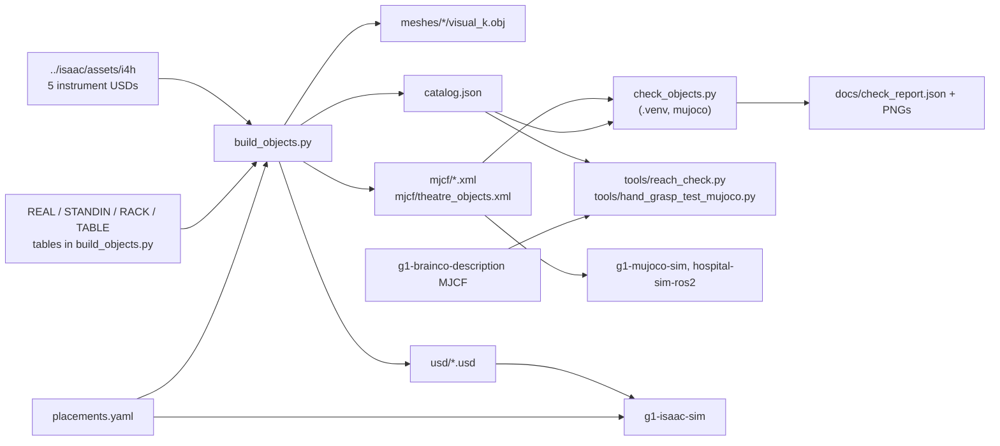

# objects: scrub-nurse props: instruments, tool rack, instrument table, surgeon

This folder is the `objects/` half of `hospital-sim-env`. It holds everything that the scrub-nurse mission
handles, as MJCF for MuJoCo and as physics-ready USD for Isaac. One script generates all of it from the i4h
instrument meshes, procedural definitions and `placements.yaml`. The generator reads the real instruments
through the `../isaac/assets/i4h` switch, so install the i4h assets first (see
[../README.md](../README.md)). The G1-specific scripts in `tools/` need the sibling repository
`g1-brainco-description`. The file `../README.md` lists who consumes the outputs and the licences.

Paths below are relative to this folder. The commands run from the root of the master checkout
(`hospital-sim`), whose `.venv` holds mujoco. The commands in daily use are:

```bash
hospital-sim-env/objects/build.sh        # regenerate meshes/, mjcf/, usd/, catalog.json (about 1 min), then check_objects.py
.venv/bin/python hospital-sim-env/objects/check_objects.py              # compile + settle-in-rack test + preview renders (docs/)
.venv/bin/python hospital-sim-env/objects/tools/reach_check.py          # G1 IK reach to every slot   -> docs/reach_report.json
.venv/bin/python hospital-sim-env/objects/tools/hand_grasp_test_mujoco.py   # Revo2 in-hand grasp test -> docs/hand_grasp_spec.json
./g1-isaac-sim/run.sh --stage                          # after a rebuild: Isaac theatre layer (g1-isaac-sim/usd/)
```

Never edit the generated files by hand. The file `placements.yaml` is the single source of object poses for
both simulators. The script `build_objects.py` reads it to write `mjcf/theatre_objects.xml` and
`catalog.json:world_poses`. The script `g1-isaac-sim/make_theatre_layer.py` reads it to write
`g1-isaac-sim/usd/theatre_instruments.usd`. The mission derives `g1_mission/config/locations.yaml` from it.

## How it works

The script `build_objects.py` first deletes `meshes/`, `mjcf/` and `usd/` and loads `placements.yaml`. Two
tables at the top define the instruments. The table `REAL` has five i4h meshes. Each entry gives the asset
path under `../isaac/assets/i4h`, the prims to include, the catalogue mass, the source and the licence. The
tweezers also have an explicit `flip`.

The table `STANDIN` has the Adson forceps and the needle driver. The functions `build_adson_forceps()` and
`build_needle_driver()` build them from box, capsule, cylinder, sphere and torus primitives. The list
`INSTRUMENTS` fixes the slot order. The constants `RACK` and `TABLE` hold the rack and table dimensions.

The function `build_instruments()` runs `extract_usd_mesh()` on each real asset. That function opens the USD
with `pxr` and walks the meshes under the include prims, instance proxies included. It fan-triangulates them
and applies the local-to-world transform and `metersPerUnit`. It groups the triangles by material colour.
The colour is the diffuse colour of the shader, or the mean of a 64x64 downsample of its diffuse texture
read with Pillow.
The function `canonical_transform()` sorts the bounding box extents into long, wide and thin axes and maps
them to z, x, y. It flips the long axis unless the wider end is already at the top, or unless `flip` is
given. As a result, +z points at the handle and the origin is on the axis at the tip.

The script decimates each colour group to at most 12000 faces and writes it as `meshes/<name>/visual_<k>.obj`.
The collision comes from `slice_boxes()`: it cuts the mesh every 10 mm, and each slice's axis-aligned
section bounds, padded 0.5 mm, become one box. Finger rings turn solid. The setting
`COLLISION_MODE = "hulls"` swaps this for CoACD convex parts with at most 60 vertices (`convex_parts()`,
`limit_hull()`). The script writes those as `collision_<k>.obj`. The function `mass_props()` scales the
collision geometry to the catalogue mass at uniform density. It returns the centre of mass, the principal
inertia (floored at 1e-6 kg m2) and the principal axes.

The function `rack_geometry()` sizes the rack from the instruments. Slot `i` sits at `y = (i - 3) * 0.09`.
Its guide hole is the bounds of the collision section swept from the tip to 2 mm above the guide top (0 to
52 mm). The hole gets 2.5 mm of clearance and is at least 6 mm wide. The tip pocket uses the 0 to 10 mm
section plus 2.5 mm. The base plate, the tip plate, the guide plate, the end posts and the coloured slot
markers are boxes from `perforated_plate()`.

The function returns the rack primitives, the per-slot `instrument_pos` and the plate heights. The functions
`table_geometry()` and `surgeon_geometry()` are fixed primitive lists; the surgeon carries the `surgeon_hand`
site. The script then sets the grasp region per instrument. The region begins at the guide top plus 20 mm (70 mm
above the tip). It ends at the length minus 45 mm for the scissors and the needle driver (rings), or at the
length minus 8 mm otherwise. The `<name>_grasp` site sits at the middle of the region.

Three writers produce the outputs. The function `write_mjcf()` writes `mjcf/<name>.xml` with:

- a `<default>` class pair;
- mesh assets with paths relative to `mjcf/`;
- the body `<name>` at the origin, with a `<freejoint>` and an `<inertial>` for instruments and none for
  the static table, rack and surgeon;
- visual geoms in group 2;
- collision geoms in group 3 for instruments (`contype 1 conaffinity 1 condim 4`, friction
  `0.8 0.02 0.0005`, `solref 0.004 1`, `solimp 0.95 0.99 0.001`, margin 0.5 mm) or in group 0 for furniture
  (`condim 3`, friction 0.6);
- the sites.

The function `write_usd()` writes `usd/<name>.usd` with defaultPrim `/<name>`. The prim holds:

- a `Looks` scope with `UsdPreviewSurface` materials and a `PhysicsMaterial` (instruments: static 0.8,
  dynamic 0.7, restitution 0; furniture: 0.6 and 0.54);
- `visual/`. The real instruments reference the i4h asset through `../../isaac/assets/i4h/<src>` with the
  canonical transform. The function `strip_asset_physics()` deletes the asset's own physics API schemas. It
  also deactivates the `Collisions`, `Sites` and other unused prims of the asset. The stand-ins get
  `UsdGeom.Mesh` prims;
- `collision/`: Cube, Capsule, Cylinder and Sphere prims with `CollisionAPI`, `PhysxCollisionAPI` (contact
  offset 2 mm, rest offset 0) and purpose `guide`;
- the site Xforms;
- for instruments, `PhysicsRigidBodyAPI`, `MassAPI` (mass, COM, diagonal inertia, principal axes) and
  `PhysxRigidBodyAPI`. The PhysX settings are CCD on, 16 position and 4 velocity solver iterations, and a
  maximum depenetration velocity of 1 m/s. The sleep threshold is 0.0005 and the stabilization threshold
  is 0.0001.

The function `write_catalog()` writes `catalog.json`.

World poses come last. The table and surgeon poses are `pos` and `yaw` from `placements.yaml`. The rack pose
is the table pose times its `parent`-relative pose. Each instrument pose is the rack pose times the
`instrument_pos` of its slot. An assertion checks that `rack_slots` in the YAML matches the `INSTRUMENTS`
order.

The function `write_theatre_mjcf()` writes `mjcf/theatre_objects.xml`: one
`<frame pos quat><attach model body/></frame>` per object, plus a floor and a light. The model options are
`timestep 0.002`, `implicitfast`, `cone elliptic` and `impratio 10`.

The script `build.sh` runs all of this with `uv run --no-project --python 3.11 --with usd-core --with trimesh
--with coacd --with numpy --with scipy --with pyyaml --with pillow --with fast-simplification --with networkx`.
It then runs `check_objects.py` under the master `.venv`. The check compiles all 11 MJCF files and steps
`theatre_objects.xml` for 1500 steps (3 s). It requires every instrument to stay upright (tilt under 12 deg),
in its slot (xy drift under 15 mm) and at rest (speed under 0.01 m/s). It renders `docs/theatre_setup.png`,
`rack_closeup.png`, `rack_robot_view.png` and `instrument_lineup.png`; skip the renders with `--no-render`.
It writes `docs/check_report.json` and exits 1 on failure.

## Architecture

The diagram shows the generator, its inputs, its outputs and their consumers.



The table lists the main pieces and their files.

| Piece | File | Role |
|---|---|---|
| Generator | `build_objects.py` | meshes, MJCF, USD, catalog from i4h meshes, primitives and `placements.yaml` |
| Runner | `build.sh` | `uv run` with Python 3.11 and the package set, then `check_objects.py` |
| Poses | `placements.yaml` | table, rack and surgeon poses, slot order, robot stances, props to remove |
| Checks | `check_objects.py` | MuJoCo compile, 3 s settle test, preview renders, `docs/check_report.json` |
| Reach | `tools/g1_ik.py`, `tools/reach_check.py` | damped-least-squares arm IK; reach to every slot from the stance |
| Grasp | `tools/hand_grasp_test_mujoco.py` | in-hand grasp and shake test; writes `docs/hand_grasp_spec.json` for the Isaac twin |

## Dependencies

The system dependencies are:

- Ubuntu 22.04;
- `uv` 0.12.19, which fetches Python 3.11.16 and the packages below;
- the master `.venv` (Python 3.10.12, system site-packages) for the checks;
- the i4h 0.7.0 assets behind `../isaac/assets/i4h` (see `../README.md`);
- `g1-brainco-description` for `tools/`.

This folder needs no Isaac Sim, ROS 2 or GPU. The table gives the Python imports and versions per script.

| Script | Interpreter | Third-party imports | Version |
|---|---|---|---|
| `build_objects.py` | `uv run --no-project --python 3.11 --with ...` (`build.sh`) | `numpy`, `trimesh`, `yaml`, `pxr`, `PIL`, `coacd` (hulls mode only) | usd-core 26.8, trimesh 5.1.1, coacd 1.0.14, numpy 2.4.6, scipy 1.17.1, pyyaml 6.0.3, pillow 12.3.0, fast-simplification 0.2.0, networkx 3.6.1 (resolved 2026-10-10; `scipy`, `fast-simplification` and `networkx` are trimesh back-ends for sections and decimation) |
| `check_objects.py` | `.venv/bin/python` | `mujoco`, `numpy`, `PIL` | mujoco 3.14.0, numpy 1.26.4 (`.venv` freeze); Pillow 9.0.1 from Ubuntu `python3-pil` through system site-packages |
| `tools/reach_check.py`, `tools/g1_ik.py` | `.venv/bin/python` | `mujoco`, `numpy`, `yaml` | mujoco 3.14.0, numpy 1.26.4, PyYAML 6.0.3 |
| `tools/hand_grasp_test_mujoco.py` | `.venv/bin/python` | `mujoco`, `numpy`, `imageio` (`--video` only) | mujoco 3.14.0, numpy 1.26.4, imageio 2.38.0 |

The file `../requirements.txt` pins the generator set for `uv run --with-requirements`. Do not install it
into the master `.venv`, because it pins numpy 2.4.6 and the `.venv` holds numpy 1.26.4.

## Items

The canonical instrument frame has +z along the long axis towards the handle or finger rings, with the
origin on the axis at the tip end. An instrument that stands in the rack therefore has the orientation of
the rack, with z = 0 at its tip. The +x axis is the wide transverse direction (the plane of the rings or
jaws), and +y is the thin one. In the rack, +x points away from the robot. The topic `/sim/objects` and the
`pose` of any detection on `/g1/perception/detections` use this frame. The table lists every object with its
size, mass, grasp region and source.

| Name (= label) | What | Size x by y by z (mm) | Mass | Grasp region z (mm) | Source / licence |
|---|---|---|---|---|---|
| `scalpel_handle` | scalpel (handle + blade), blade down | 14 x 3 x 153 | 25 g | 70 to 145 | i4h OR suite `SurgicalInstruments_A/sm_scalpelshandle_a01_01` (replaced the earlier procedural stand-in), Apache-2.0 |
| `adson_forceps` | Adson tissue forceps, 120 mm, STAND-IN | 8 x 10 x 120 | 16 g | 70 to 112 | procedural (this repository) |
| `angled_tweezers` | angled tweezers, tips down | 20 x 15 x 160 | 30 g | 70 to 152 | i4h Lightwheel `AngledTweezers001`, CC BY-NC 4.0 |
| `scissors` | Mayo scissors, rings up | 58 x 20 x 190 | 85 g | 70 to 145 (shanks; rings above) | i4h scissor workflow `Props/SurgicalInstruments/SurgicalScissors.usd`, Apache-2.0 |
| `needle_driver` | Mayo-Hegar needle driver 180 mm (7 in), rings up, STAND-IN | 57 x 9 x 179 | 62 g | 70 to 134 (straight shanks; rings from 154) | procedural (this repository) |
| `veress_needle` | Veress (pneumoperitoneum) needle, hub up | 19 x 10 x 214 | 20 g | 70 to 206 (hub 150 to 206) | i4h Lightwheel `PneumoperitoneumNeedle001` (cap removed), CC BY-NC 4.0 |
| `trocar` | laparoscopic trocar, head up | 65 x 53 x 145 | 60 g | 70 to 137 (cannula + head) | i4h Lightwheel `Trocar002`, CC BY-NC 4.0 |
| `tool_rack` | 7-slot upright rack, 90 mm pitch (static) | 124 x 640 x 58 | - | - | procedural |
| `instrument_table` | Mayo-stand-like cantilever tray, top 0.78 m (static) | 510 x 760 x 800 | - | - | procedural |
| `surgeon` | static mannequin 1.84 m, right hand held out palm-up, site `surgeon_hand` (static) | 538 x 731 x 1838 | - | hand site 2 cm above the palm | procedural |

- The mission pick results for this build come from `g1_mission/scripts/offline_trials.py`. The scissors,
  the angled tweezers and the needle driver picked 5/5 each, both without and with rack offsets of +-2 cm
  and +-0.08 rad. The scalpel, the Adson, the Veress and the trocar picked 3/3 each.
- Only two stand-ins remain: the Adson forceps and the needle driver. They are box, capsule and torus
  models with catalogue dimensions and masses. The i4h OR suite has `sm_forceps` (a 180 mm dressing
  forceps) and `sm_clamps` (a hemostat), but they are different instruments and are not used. To replace a
  stand-in, add a mesh entry to `REAL` in `build_objects.py`.
- The real instruments use a stack of boxes for collision, one per 10 mm slice along the axis. Each box is
  the axis-aligned bounds of the collision section in that slice, and finger rings become solid. The
  stand-ins use their primitives. CoACD convex parts are still available (`COLLISION_MODE = "hulls"`).
  PhysX let the thin, curved hulls of the Mayo scissor blades through the rack guide (25 deg to 35 deg of
  lean in Isaac against 5 deg in MuJoCo). Boxes behave the same in both engines.
- The masses are typical catalogue values. The script computes the inertia from the collision geometry at
  uniform density, with a floor of 1e-6 kg m2 applied identically in MJCF and USD. The friction is 0.8 for
  instruments (MuJoCo `condim 4`; USD static 0.8 and dynamic 0.7) and 0.6 for furniture. The file
  `catalog.json` has every number: COM, principal inertia, bboxes, rack slot geometry and world poses.
- The Lightwheel assets are CC BY-NC 4.0 (non-commercial, attribution). The i4h scissors and the OR-suite
  scalpel are Apache-2.0.

## Tool rack and instrument table design

- Hand size drives the pitch. The Revo2 hand is about 226 x 171 x 56 mm (wrist to fingertip, finger-stack
  width, palm thickness), with 16 mm to 18 mm wide fingers. A wrap or pinch around an upright instrument
  puts the palm on one side and the fingers on the other. The grasp therefore needs about +-45 mm along the
  row. The 90 mm pitch leaves at least 58 mm from the axis of a grasped instrument to the edge of its
  neighbour. This holds even next to the 65 mm trocar head, which is at the end slot. Rings and jaws point
  at the robot, never into the neighbouring slots.
- The instruments stand upright, tips down, in a two-level guide, and come out with a straight lift.
  - A tip plate with pockets (0 to 8 mm above the tip) and a guide plate (40 to 50 mm) hold each instrument
    near vertical.
  - The script sizes each guide hole per instrument from the swept collision section. Everything from the
    tip up to 2 mm above the guide top passes through the guide during a straight lift. This matters
    because the curved scissor tips and the angled tweezer tips sit up to 11 mm off the shank axis. The
    clearance is 2.5 mm per side, with a 6 mm minimum hole. The pockets use the tip section plus 2.5 mm,
    with a 6 mm minimum.
  - Holes sized only at guide height jammed the scissors (8.8 mm) and the tweezers (4.2 mm) during the lift.
  - Gravity holds the instruments upright. The centre of mass of each instrument lies on the tight side of
    its hole, so it leans against that wall.
  - The checks are:
    - The script `ros2_ws/src/hospital-sim-ros2/g1_mission/scripts/check_extraction.py` reports that all 7
      instruments lift clear (0.0 mm) through 10 cm.
    - The 3 s settle test gives a tilt of at most 3.5 deg in MuJoCo and at most 5.0 deg in Isaac
      (`g1-isaac-sim/tools/rack_settle_test.py`).
  - The instruments protrude 70 mm to 165 mm above the guide. The hand grasps from 20 mm above the guide up
    to a point below the rings or the hub.
- The slot order runs along rack +y, which is world +x (the left of the robot when it faces the table):
  - 0 scalpel_handle;
  - 1 adson_forceps;
  - 2 angled_tweezers;
  - 3 scissors;
  - 4 needle_driver;
  - 5 veress_needle;
  - 6 trocar.
  The coloured slot markers are on the robot-side edge.
- The table height is 0.78 m (tray top). In the G1 home pose the shoulder is at 1.076 m and the elbow is at
  0.889 m. The grasp sites (0.86 m to 0.93 m) are therefore at about elbow height. The D435 (1.258 m,
  pitched 47.6 deg down) sees the whole rack from the stance. A Mayo stand is cantilevered: the post and the
  H-base are on the far side, so the feet of the robot never touch them. The tray is enlarged to
  760 x 460 mm (the large Mayo tray size) for the 7 x 90 mm rack.
- WARNING: Raise the arms before the last step into `theatre_instrument_table`, or the hands hit the tray
  and the rack.
- At the home pose the hands are at z 0.67 m to 0.84 m, and 0.22 m to 0.37 m ahead of the pelvis. At that
  stance this is inside the 0.78 m tray. With finger collisions on in Isaac, the contact chatters and knocks
  instruments.
- The reach check (`tools/reach_check.py`) fixes the pelvis at the stance. Its damped-least-squares IK puts
  the grasp point of the hand on each grasp site with the fingers levelled forward. The results are:
  - Arm only: the right hand reaches slots 0 to 4 (error at most 4.3 mm), and the left hand reaches slots 1
    to 6 (at most 17 mm, at slot 5).
  - With the waist: both hands reach all 7 slots, with the outer slots near the waist-roll limit.
  - Pick the hand by slot: right for 0 to 3, left for 4 to 6.

## Grasp physics (both simulators)

The script `tools/hand_grasp_test_mujoco.py` and its Isaac twin `g1-isaac-sim/tools/hand_grasp_test.py` use
the same setup. A fixed-base G1 holds its right hand in free space. The test places the instrument at the
pinch point and pinches it at its COM height. The pinch point is at thumb_aux 0.8, where the thumb pad meets
the index and middle pads at (142, 45, 15) mm in the wrist frame. The hand closes, then the test releases
the instrument and holds for 1.5 s. It then shakes for 3 s: wrist +-0.35 rad and shoulder +-0.25 rad at
1 Hz.

"Held" means within 80 mm of the release pose. "Firm" means under 10 mm of slip during the shake. The option
`--search` grid-searches the in-hand position first. The option `--video out.mp4` records the scissors test.
The table gives the results in both simulators.

| | MuJoCo | Isaac, hand physics fixed | Isaac, finger colliders raw |
|---|---|---|---|
| retained | 6/7 (Veress drops) | 5/7 final run (scalpel and Adson drop; 7/7 in an earlier run) | 6/7 (trocar drops) |
| firm through the shake | 1/7 (12 to 19 mm creep) | 5/7 (at most 7.7 mm) | 5/7 |

A single generic pinch is not a grasp design. A closed Revo2 fist cannot squeeze anything thinner than about
25 mm. Thin instruments therefore need the thumb-index pinch, and they swing 20 deg to 60 deg about it while
they seat. Per-instrument grasps belong to the pick skill of the mission. The point of these tests is that
finger contacts are stable in both engines: no NaN and no explosion. See `g1-isaac-sim/README.md` for the
fall test that motivated the Isaac fix.

## Placement (world frame; `placements.yaml`)

The table gives the world pose of each object and each robot stance.

| Object | World pose | Notes |
|---|---|---|
| `instrument_table` | (25.60, -20.60), yaw -pi/2 | theatre, south-east of the operating table; local +x (far side) = world -y |
| `tool_rack` | on the tray, 0.08 m toward the robot | row along world x (25.33 to 25.87), y about -20.52 |
| `surgeon` | (23.85, -19.05), yaw pi (facing west, at the operating table's east side) | `surgeon_hand` site at world (23.60, -18.70, 1.02) |
| robot stance `theatre_instrument_table` | pelvis (25.60, -20.19), yaw -pi/2 | pelvis 0.33 m from the rack row |
| robot stance `theatre_surgeon_side` | pelvis (23.80, -18.25), yaw -pi/2 | hand site 0.45 m ahead, 0.20 m to the right |

The surgeon stands where the two OR-suite surgical stools were, so `remove_scene_props` lists
`sm_surgicalchair_a01_01/_02`. The Isaac theatre layer deactivates them together with their collider boxes.
The MuJoCo theatre must skip those two boxes in `g1-mujoco-sim/worlds/hospital_boxes.json`.

The format of `placements.yaml` is:

- `frame: world`;
- `objects.<name>` with `pos: [x, y, z]`, `yaw` (radians about +z) and an optional `parent` (the pose is
  then in the frame of the parent);
- `rack_slots.<instrument>: <index>`, which must follow the `INSTRUMENTS` order in `build_objects.py`;
- `robot_stances.<location>: [x, y, yaw]`;
- `remove_scene_props`, prim names under the `Props` of the OR suite.

## Using the MJCF

Each `mjcf/<name>.xml` is a self-contained model. The body `<name>` sits at the origin, with a free joint
for instruments and none for static props. The mesh paths are relative to `mjcf/`, so use `<model>` and
`<attach>`. A plain `<include>` breaks the relative mesh paths:

```xml
<asset>
  <model name="scissors" file="../hospital-sim-env/objects/mjcf/scissors.xml"/>   <!-- path relative to your scene file (here: a sibling repository) -->
</asset>
<worldbody>
  <frame pos="25.605 -20.52 0.788" quat="0.7071 0 0 -0.7071">      <!-- from catalog.json world_poses -->
    <attach model="scissors" body="scissors" prefix=""/>
  </frame>
</worldbody>
```

The file `mjcf/theatre_objects.xml` does this for all 10 objects plus a floor. In Python, use
`mujoco.MjSpec` and `frame.attach_body(child_spec.body(name), "", "")`. The pelvis body of the robot MJCF
carries its own height. Set its `pos` to 0 when you attach it under a stance frame.

The contact classes are:

- The instrument collision geoms are in group 3 with `contype=conaffinity=1`, `condim=4` and a margin of
  0.5 mm. They collide with the robot (collision geoms `contype 2 / conaffinity 1`) and with the world.
- The furniture collision is in group 0, so the lidar sees it. The visual geoms are in group 2.
- The sites are `<name>_grasp` (the centre of the grasp region) and `surgeon_hand`. Use
  `cone="elliptic" impratio="10"`.

## Using the USD

The file `usd/<name>.usd` has defaultPrim `/<name>`, with `visual/`, `collision/` (guide purpose) and site
Xforms.

- The instruments have `PhysicsRigidBodyAPI` and `MassAPI` on the root. The PhysX tuning is CCD on, 16/4
  solver iterations and a maximum depenetration of 1 m/s. The contact offset is 2 mm and the rest offset
  is 0.
- The real instruments reference the i4h asset through `../../isaac/assets/i4h/...`. This keeps the textures
  and the lite/full switch of the repository. The writer strips the asset's own rigid bodies and colliders
  with `delete apiSchemas`, and it deactivates the collider, site and cap prims of the asset.
- The furniture and the surgeon are static colliders.
- The root prim carries the `customData` entries `hg1:title`, `hg1:source` and `hg1:licence`.

## catalog.json format

The table lists the top-level keys of `catalog.json`.

| Key | Content |
|---|---|
| `generated_by`, `frame_convention` | provenance and the canonical frame text |
| `labels` | the 7 instrument names in slot order |
| `instruments.<name>` | `title`, `stand_in`, `source`, `licence`, `size_xyz_m`, `bbox_min`, `bbox_max`, `mass_kg`, `com`, `inertia_diag`, `inertia_quat` (wxyz), `collision` (for example `"16 primitives"`), `grasp.z_range`, `grasp.site`, `mjcf`, `usd`, `asset` (i4h path or null), `canonical_flip` |
| `furniture.<name>` | `title`, `size_xyz_m`, `bbox_min`, `bbox_max`, `static: true`, `mjcf`, `usd`, `sites` (the surgeon's `surgeon_hand`) |
| `rack` | the `RACK` constants plus `half_len`, `guide_top` (0.058), `base_top` (0.008) and `slots.<name>` with `index`, `y`, `hole_half`, `instrument_pos` (rack frame) |
| `table` | the `TABLE` constants |
| `world_poses.<name>` | `pos` and `quat` (wxyz) in the world frame for every object and `surgeon_hand` |
| `robot_stances`, `remove_scene_props` | copied from `placements.yaml` |

The file paths in the catalog (`mjcf`, `usd`, `asset`) are relative to the root of the master checkout.

## Files

The table lists the files of this folder.

| Path | What |
|---|---|
| `placements.yaml` | world poses, rack slots, robot stances, props to remove (edit this) |
| `build_objects.py`, `build.sh` | the generator (uv, Python 3.11: usd-core, trimesh, coacd, numpy, scipy, pyyaml, pillow, fast-simplification, networkx) |
| `check_objects.py` | compile, settle test, renders to `docs/` |
| `tools/g1_ik.py`, `tools/reach_check.py` | arm IK helper, reach analysis to `docs/reach_report.json` |
| `tools/hand_grasp_test_mujoco.py` | in-hand grasp test, writes `docs/hand_grasp_spec.json` (read by the Isaac twin) |
| `catalog.json` | generated: dimensions, masses, inertia, grasp regions, rack slot geometry, world poses |
| `meshes/<name>/` | generated OBJ visuals (one per colour) |
| `mjcf/`, `usd/` | generated models |
| `docs/` | `theatre_setup.png`, `rack_closeup.png`, `rack_robot_view.png`, `instrument_lineup.png`, `check_report.json`, `reach_report.json`, `hand_grasp_spec.json` |
